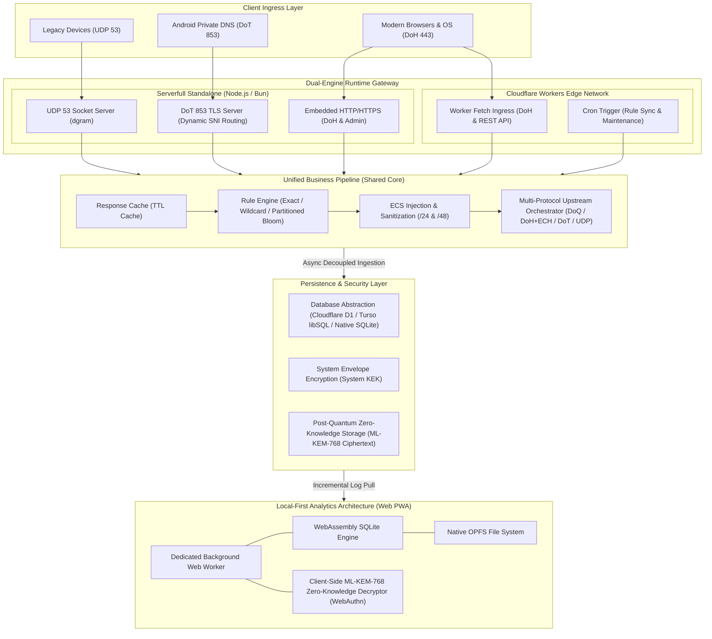
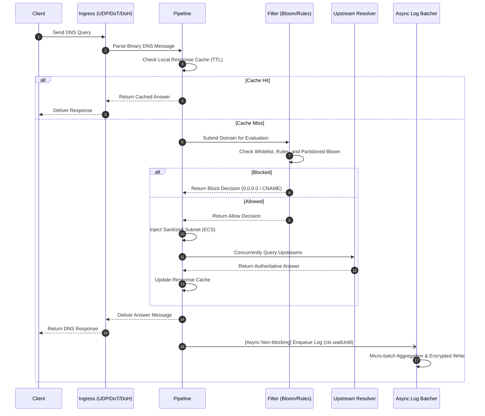
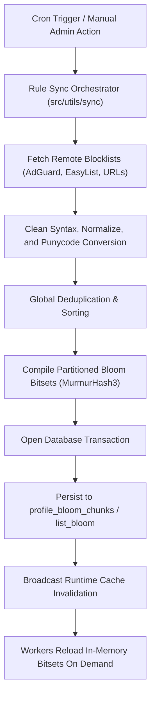
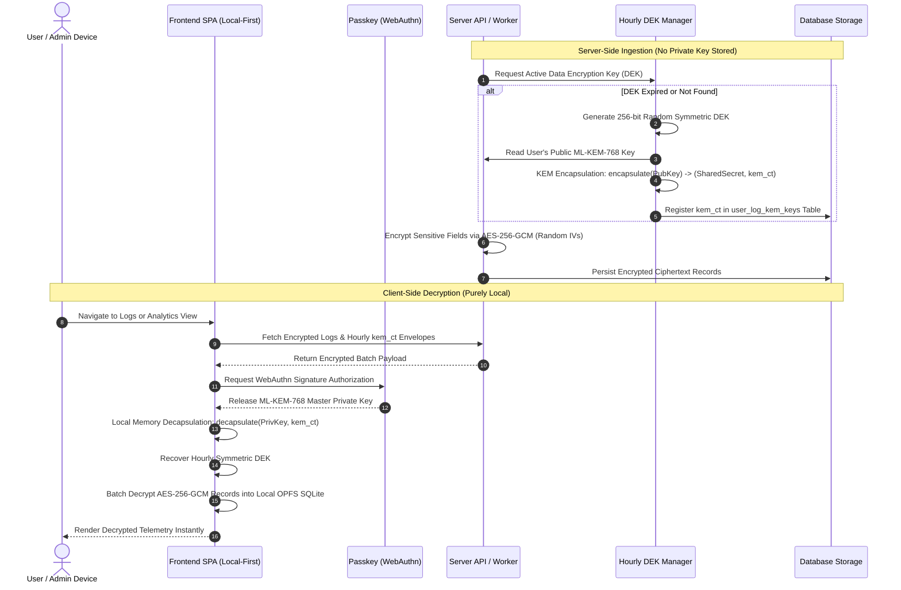
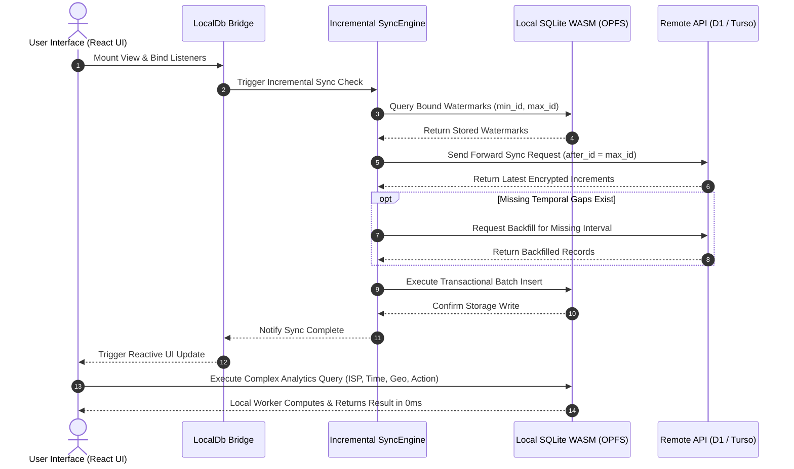

DNS Worker utilizes a shared core pipeline with a dual runtime engine architecture, supporting both Serverless deployment on Cloudflare Workers edge network and Serverfull daemon operation on standalone servers/VPS. The system covers universal DNS protocol resolution, partitioned bloom filter rule evaluation, post-quantum end-to-end encryption (PQC E2EE), and client-side local-first (Local-First OPFS) telemetry analysis.

---

## Architecture Topology

Through an adaptive runtime abstraction layer, the same resolution pipeline runs across both edge serverless environments and dedicated host environments.

### Dual-Engine Unified Topology



---

### Codebase Structure

The project code is organized into runtime core, frontend SPA, database migrations, and automated test suites:

```text
ObexDNS/
├── src/                               # Shared backend runtime (Serverless & Serverfull)
│   ├── index.ts                       # Cloudflare Workers entry and cron triggers
│   ├── api/                           # RESTful & WebSocket API routing
│   │   ├── auth/                      # Authentication submodules (Turnstile, lock screen, recovery)
│   │   ├── account/                   # User profile, security credentials, WebAuthn, E2EE
│   │   ├── profiles/                  # Access points, rulesets, audit logs, and WS streaming
│   │   ├── doh.ts                     # RFC 8484 DoH standard request handler
│   │   └── system.ts                  # System settings and telemetry endpoints
│   ├── pipeline/                      # DNS pipeline core (cache, filter, ECS, upstream router)
│   ├── models/                        # Domain models and DAL (Profile, Rule, List, KEM Key, Session)
│   ├── lib/                           # Security and database adapters
│   │   ├── turso/                     # Turso / libSQL Hrana v2 protocol adapter
│   │   ├── crypto/                    # Cryptographic suites & hourly KEM DEK rotation manager
│   │   └── webauthn/                  # FIDO2 / WebAuthn challenge & verification
│   ├── serverfull/                    # Standalone daemon (UDP 53, DoT 853, embedded HTTP, CLI, services)
│   └── utils/                         # Utilities (DNS codecs, ECH codecs, rule sync, bloom compiler)
│
├── web/                               # Local-First Frontend SPA (React + TypeScript + Vite)
│   ├── src/views/                     # View components (Stats, Logs, Rules, Profiles, Settings)
│   ├── src/services/localDb/          # Local SQLite domain services (Bridge, Sync, Query, Maintenance)
│   ├── src/workers/                   # Background Web Worker (hosting SQLite WASM + OPFS)
│   └── src/crypto/                    # Browser-side NIST FIPS 203 ML-KEM-768 decryptor
│
├── migrations/                        # Versioned SQL database schema migrations
└── test/                              # Automated test suites (Turnstile, Turso, Serverfull daemon)
```

---

## System Layering and Component Design

DNS Worker is structured into five vertical architectural layers:

### 1. Multi-Protocol Ingress Layer

Normalizes heterogeneous network payloads into standard binary DNS messages:

- **UDP 53 Ingress (`src/serverfull/udp.ts`)**: Binds to port `53` via Node.js `dgram` using zero-copy binary buffer slicing to read header flags directly, with sliding-window rate limiting to mitigate amplification attacks.
- **DoT 853 Ingress (`src/serverfull/dot.ts`)**: Binds to port `853` via Node.js `tls`, handles RFC 7858 two-byte framing, and extracts the TLS SNI (`<profileKey>.dns.example.com`) during handshakes for multi-tenant isolation with native Android Private DNS.
- **DoH / HTTP Ingress (`src/api/doh.ts`, `src/serverfull/http.ts`)**: Implements RFC 8484 specifications (supporting GET Base64URL and POST binary streams), supports HTTP/2 and HTTP/3, and injects RFC 9460 HTTPS / SVCB records for Encrypted Client Hello (ECH) support.

### 2. Filtering & Bloom Engine Layer

Arbitrates whether a domain query is permitted or blocked:

- **Three-Tier Cascade Pipeline**:
  1. **Whitelist Bypass**: Checks user-defined allowlists; matches bypass further inspection immediately.
  2. **Exact & Wildcard Rules**: Evaluates domain tree hash maps in sub-microseconds.
  3. **Partitioned Bloom Filters**: Compresses massive blocklists (hundreds of thousands of domains) into partitioned bitsets (256KB-1MB per chunk) using MurmurHash3, maintaining zero false negatives and a false positive rate under 0.1%, reducing memory footprint by over 90%.
- **Rule Sync Pipeline (`src/utils/sync/`)**: Periodically downloads blocklist sources, cleans formatting, performs Punycode conversion and deduplication, writing compressed chunks directly to the database.

### 3. Core Resolver & Upstream Router Layer

Handles recursive query resolution for allowed requests:

- **Pipeline Orchestrator (`src/pipeline/index.ts`)**:
  - **Response Cache (`src/pipeline/cache.ts`)**: Maintains an in-memory TTL cache, synthesizing synthetic block answers (`0.0.0.0` or custom CNAME) with short TTL to suppress repeated client requests.
  - **ECS Sanitization (`src/utils/dns/injectEcs.ts`)**: Truncates client IPs to `/24` (IPv4) or `/48` (IPv6) subnets, maintaining CDN edge geographic proximity without leaking individual IP addresses.
- **Multi-Protocol Upstream Pooling**: Concurrently queries DoQ (`quic://`), DoH+ECH (`https://`), DoT (`tls://`), and standard UDP/TCP upstreams, with parallel racing and automatic circuit-breaking fallbacks.

### 4. Data Persistence & Security Layer

Provides uniform storage abstractions and sensitive data protection:

- **Unified Database Driver**: Provides a consistent `D1Database` contract across Cloudflare D1, Turso / libSQL (via Hrana v2 HTTP Pipeline with statement batching and read caching), and native `node:sqlite`.
- **System Envelope Encryption (`src/utils/envelope.ts`)**: Uses master key `KEK_v1` (with `KEK_v0` fallback) to encrypt sensitive stored values (TOTP secrets, API tokens, profile keys) with AES-256-GCM before writing to storage.
- **Asynchronous Log Decoupling (`src/pipeline/logBatcher.ts`)**: Logging events are enqueued to memory and processed in the background via Cloudflare Workers `ctx.waitUntil()` or Node.js asynchronous event loops, incurring zero latency overhead on resolution.

### 5. Frontend & Local-First Layer

Pushes telemetry computations and cryptographic decryption to the client device:

- **WASM SQLite + OPFS Storage**: Runs the official WebAssembly SQLite inside a dedicated Web Worker backed by the browser's Origin Private File System (OPFS).
- **0ms Instant Query Execution**: Full-text searching, client filtering, and geographic telemetry aggregate in `< 1ms` inside the worker without cloud database read quota consumption.
- **Client-Side Post-Quantum E2EE (`web/src/crypto/pqc.ts`)**: With E2EE enabled, the server holds only ciphertext; the browser authorizes via WebAuthn Passkey (biometrics/hardware key) to unseal the user private key in memory, decrypting logs purely locally.

---

## Data Flows and Interaction Mechanisms

### 1. End-to-End DNS Query and Resolution Flow



---

### 2. Rule Subscription, Compilation & Bloom Chunking Flow



---

### 3. Log Ingestion & Post-Quantum Zero-Knowledge E2EE Flow



---

### 4. Local-First OPFS Incremental Sync and Query Flow


