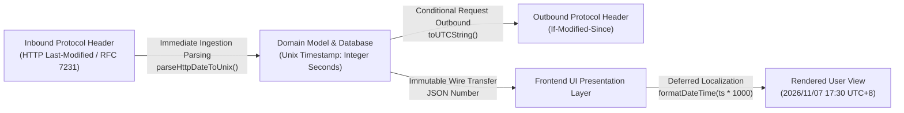

As a hybrid application engineered to run both on Cloudflare Workers edge network (Serverless) and dedicated standalone hosts (VPS/Docker Serverfull), DNS Worker enforces rigorous design and coding standards to preserve data integrity, security, and long-term maintainability.

---

## Standard Level Definitions

To balance engineering rigor with development agility, every guideline in this document is categorized with an explicit level badge:

| Level Badge | Scope & Authority | Adjudication Principle |
| :--- | :--- | :--- |
| **`[Strict]`** | **Non-negotiable foundational requirements**.<br/>Directly impacts security boundaries (SSRF, RBAC bypass), data integrity (immutable migration hashes, integer timestamps), protocol mandates (RFC 8484 HTTP/2 minimum), or static analysis (disallowing `any`). | Minimized to only critical invariants. Must pass continuous integration and peer review with zero waivers. |
| **`[Recommended]`** | **Core engineering standards & best practices**.<br/>Covers architectural isolation, modularity, defensive error handling, table recreation patterns, and comprehensive automated test suites. | Must be followed in all normal circumstances; deviations require explicit justification in the PR review. |
| **`[Reference]`** | **Code consistency & advanced tuning heuristics**.<br/>Covers naming conventions, human-in-the-loop markers (`TODO: [HUMAN]`), and high-QPS memory profiling. | Encouraged to improve readability, maintainability, and developer experience. |

---

## 1. Architectural & Collaborative Principles

### 1.1 Respect Architectural Layering `[Recommended]`

* **Rationale**: DNS Worker must operate both in Cloudflare Workers (serverless, no disk access) and Node.js standalone daemons (Serverfull), with a Local-First OPFS frontend. Breaking architectural boundaries leaks state and introduces coupling that undermines cross-runtime portability.
* **Good Practice**:
  ```typescript
  // Presentation layer only accesses state via defined service boundaries
  import { keepProfileList } from '@/services/profiles';
  await keepProfileList(profileId, listId);
  ```
* **Anti-Pattern**:
  ```typescript
  // Anti-pattern: React components directly importing Node.js database drivers or executing raw SQL
  import { DatabaseSync } from 'node:sqlite';
  const db = new DatabaseSync('local.db');
  db.prepare('UPDATE lists SET is_system = 0 WHERE id = ?').run(listId);
  ```

### 1.2 Minimally Invasive Modifications `[Recommended]`

* **Rationale**: In human-AI collaborative workflows, restricting the blast radius of changes preserves existing tested code, minimizes regression risk, and keeps `git blame` histories clean.
* **Good Practice**: When adding features like admin list revocation, extend [`src/models/list.ts`](file:///d:/Coding/OriginalProject/ObexDNS/src/models/list.ts) with `revokeSystemList` and wire the API endpoint, keeping existing query methods and schemas intact.
* **Anti-Pattern**: Reformatting or renaming unrelated functions across hundreds of lines while fixing an isolated bug.

### 1.3 Modularity & Single Responsibility `[Recommended]`

* **Rationale**: Pure functions and isolated modules simplify unit testing, prevent subtle side effects, and are portable across Workers and Node.js runtimes.
* **Good Practice**:
  ```typescript
  // Extract parsing logic into pure functions independent of HTTP servers
  export function parseAdGuardLine(line: string): ParsedRule | null {
    // Pure text parsing...
  }
  ```
* **Anti-Pattern**: Handling HTTP parsing, remote downloads, regex evaluation, Bloom filter bit operations, and database writes all in a single monolithic controller.

### 1.4 Human-in-the-Loop Markers `[Reference]`

* **Rationale**: Explicitly annotate code paths requiring human decisions or environment-specific credentials to prevent automated workflows from making invalid assumptions.
* **Good Practice**:
  ```typescript
  // TODO: [HUMAN] Inject production OAuth Client Secret and encryption keys before deploying
  ```

---

## 2. Code Standardization & Strict Typing

### 2.1 Disallow `any` Escapes and Implicit Type Bypass `[Strict]`

* **Rationale**: TypeScript's static analysis is the primary safeguard for DNS wire parsing and cryptographic operations. Using `any` completely disables type checking, allowing silent type errors to crash production with `TypeError: Cannot read properties of undefined`.
* **Good Practice**:
  ```typescript
  export interface RevokeFilterResult {
    canonicalUrl: string;
    revokedProfilesCount: number;
    affectedProfileIds: string[];
    affectedUsernames: string[];
  }
  
  export async function revokeSystemList(url: string): Promise<RevokeFilterResult> { ... }
  ```
* **Anti-Pattern**:
  ```typescript
  // Anti-pattern: Using any hides missing properties and spelling mistakes at compile time
  export async function revokeSystemList(url: any): Promise<any> { ... }
  ```

### 2.2 Explicit Signatures for Exported Entities `[Recommended]`

* **Rationale**: Publicly exported functions, models, and React component props should explicitly declare their TypeScript types and return types to establish stable contracts and prevent accidental breaking changes from deep inference.
* **Good Practice**:
  ```typescript
  export interface DistributeFilterCardProps {
    toasterRef?: React.RefObject<OverlayToaster | null>;
    onSavingChange?: (saving: boolean) => void;
  }
  
  export const DistributeFilterCard: React.FC<DistributeFilterCardProps> = ({ toasterRef, onSavingChange }) => { ... };
  ```

### 2.3 Unified Naming Conventions `[Reference]`

* **Rationale**: Consistent naming across variables (`camelCase`), types/components (`PascalCase`), and constants (`UPPER_SNAKE_CASE`) clarifies identifier semantics and lifecycles at a glance.
* **Good Practice**:
  * Variables & Functions: `camelCase` (e.g., `listFetcher`, `parseHttpDateToUnix`).
  * Classes, Types, Components: `PascalCase` (e.g., `ListModel`, `ListsTable`, `SingleListSyncResult`).
  * Constants & Enums: `UPPER_SNAKE_CASE` (e.g., `DEFAULT_MAX_SYNC_DOMAINS`, `APP_VERSION`).

### 2.4 Defensive Programming for External Inputs `[Recommended]`

* **Rationale**: External DNS upstreams, third-party blocklist providers, and web forms are untrusted boundaries subject to flakiness, invalid formatting, and timeouts. Defensive guards prevent transient failures from crashing daemon threads.
* **Good Practice**:
  ```typescript
  try {
    const res = await fetchWithTimeout(url, { timeoutMs: 5000 });
    if (!res.ok) throw new Error(`HTTP ${res.status}`);
    const data = await res.json() as ExpectedPayload;
    return data?.profile?.id ?? null;
  } catch (err) {
    logger.warn(`Failed to fetch from ${url}, fallback to cache:`, err);
    return getCachedFallback();
  }
  ```
* **Anti-Pattern**:
  ```typescript
  // Anti-pattern: Assuming external endpoints never return errors or malformed payloads
  const data = (await (await fetch(url)).json()).data.items.map(x => x.url);
  ```

---

## 3. Timestamp Standardization

To eliminate timezone ambiguities, string parsing overhead, and localization mismatches, DNS Worker mandates an integer Unix timestamp architecture:



### 3.1 Integer Unix Timestamps in Database and Domain Models `[Strict]`

* **Rationale**: Text date representations (ISO-8601, RFC 2822) consume excessive storage and introduce sorting mismatches and timezone parsing bugs in SQLite/D1. Using integer Unix timestamps in seconds (`Math.floor(Date.now() / 1000)` / SQLite `INTEGER`) ensures zero-overhead comparisons and unambiguous index lookups.
* **Good Practice**:
  ```sql
  -- All time fields stored strictly as INTEGER Unix seconds
  CREATE TABLE lists (
    id INTEGER PRIMARY KEY,
    last_synced_at INTEGER,
    last_modified INTEGER
  );
  ```
  ```typescript
  const now = Math.floor(Date.now() / 1000);
  await db.prepare("UPDATE lists SET last_synced_at = ? WHERE id = ?").bind(now, listId).run();
  ```
* **Anti-Pattern**:
  ```sql
  -- Anti-pattern: Storing formatted date strings in database tables
  CREATE TABLE lists (
    id INTEGER PRIMARY KEY,
    last_synced_at TEXT -- e.g. '2026-11-08T03:45:00.000Z'
  );
  ```

### 3.2 Immediate Parsing at Ingestion & Dynamic Protocol Serialization `[Recommended]`

* **Rationale**: External protocol formats (such as RFC 7231 `Last-Modified` strings) belong solely to the wire layer. Converting to Unix timestamps at the system boundary keeps internal models clean, while outbound requests serialize on demand.
* **Good Practice**:
  ```typescript
  // Boundary parsing
  const lastModifiedHeader = response.headers.get("Last-Modified");
  const lastModifiedTs = lastModifiedHeader ? parseHttpDateToUnix(lastModifiedHeader) : null;
  
  // Outbound conditional serialization
  if (list.last_modified) {
    headers["If-Modified-Since"] = new Date(list.last_modified * 1000).toUTCString();
  }
  ```

### 3.3 Deferred Formatting in UI Presentation Layer `[Recommended]`

* **Rationale**: Date formatting, relative time ("5 minutes ago"), and user timezone offsets (`user.timezone`) are strictly view concerns. APIs returning raw numeric timestamps allow frontends full localization freedom.
* **Good Practice**:
  ```typescript
  // Presentation layer formats with user-selected timezone
  <span>{formatDateTime(list.last_synced_at * 1000, user.timezone)}</span>
  ```

---

## 4. Append-Only Database Migration Philosophy

Because schemas must run across Cloudflare D1, Turso libSQL, and standalone SQLite servers, migrations follow an immutable append-only lifecycle:

### 4.1 Past Migrations Are Immutable `[Strict]`

* **Rationale**: Once merged or deployed to production, existing migration files (`migrations/0000_*.sql` through existing sequence numbers) form an immutable baseline. Modifying them corrupts migration hashes, causes schema drift, and breaks production databases.
* **Good Practice**: When altering the `lists` table, create a new numbered migration such as `migrations/0065_add_is_system_to_lists.sql`.
* **Anti-Pattern**: Modifying `0000_init.sql` directly to add columns to existing tables.

### 4.2 SQLite Table Recreation Pattern for Schema Evolution `[Recommended]`

* **Rationale**: SQLite has limited support for altering existing column constraints or types. The standard SQLite table recreation pattern (create new table, copy sanitized data, drop old table, rename) is guaranteed safe across all SQLite engines.
* **Good Practice**:
  ```sql
  -- migrations/0066_standardize_last_modified_timestamp.sql
  CREATE TABLE global_list_metadata_new (
      id INTEGER PRIMARY KEY AUTOINCREMENT,
      url TEXT NOT NULL UNIQUE,
      last_modified INTEGER
  );
  INSERT INTO global_list_metadata_new (id, url, last_modified)
  SELECT id, url, NULL FROM global_list_metadata;
  DROP TABLE global_list_metadata;
  ALTER TABLE global_list_metadata_new RENAME TO global_list_metadata;
  ```

### 4.3 Automated Embedded Migrations Synchronization `[Recommended]`

* **Rationale**: Cloudflare Workers lacks a filesystem at runtime and cannot read `.sql` files dynamically. Generating a static TypeScript array allows seamless bootstrap migrations on serverless edge nodes.
* **Good Practice**: Run `npm run db:generate-migrations` after creating any migration SQL file.

---

## 5. Security Architecture & Defensive Design

### 5.1 Mandatory SSRF Prevention on Outbound Requests `[Strict]`

* **Rationale**: DNS services initiate outbound requests for blocklists and upstream queries. Allowing requests to private IP ranges (RFC 1918), loopback interfaces (`127.0.0.1`), or cloud metadata endpoints (`169.254.169.254`) allows attackers to probe internal networks or steal IAM credentials.
* **Good Practice**:
  ```typescript
  const safe = await isSafeUrlWithDnsCheck(targetUrl);
  if (!safe) {
    return new Response("Invalid or forbidden destination URL", { status: 400 });
  }
  ```

### 5.2 Prefer HTTP/3 for DoH with Mandatory Minimum HTTP/2 `[Strict]`

* **Rationale**:
  * **HTTP/3 is the Preferred Protocol**: Built upon UDP/QUIC, HTTP/3 (DoH3 / RFC 9114) delivers 0-RTT handshakes, completely eliminates transport-layer head-of-line blocking, and provides native resilience against packet loss on mobile networks. The system and standalone daemons should prioritize and advertise HTTP/3.
  * **HTTP/2 is the Backwards-Compatible Floor (RFC 8484 §5.2)**: In accordance with RFC 8484 §5.2 ("Clients and servers MUST NOT negotiate HTTP/1.1 for DoH"), HTTP/2 serves strictly as the backwards-compatible floor. DoH must never negotiate or fall back to HTTP/1.1.
  * **No Silent Downgrades & Transparent Diagnostics**: Incoming DoH requests over HTTP/1.1 must be rejected with `HTTP 505 (HTTP Version Not Supported)`. If an upstream DoH query fails, the actual upstream error must be surfaced transparently without silent downgrades to unencrypted protocols.
* **Good Practice**:
  ```typescript
  // 1. Advertise HTTP/3 support via Alt-Svc to upgrade modern clients to HTTP/3 (DoH3)
  res.setHeader('Alt-Svc', `h3=":${port}"; ma=86400`);

  // 2. Enforce HTTP/2 as the absolute minimum, rejecting legacy HTTP/1.1
  const httpProto = request.headers.get('X-Http-Version');
  if (httpProto && (httpProto === 'HTTP/1.0' || httpProto === 'HTTP/1.1' || httpProto === '1.0' || httpProto === '1.1')) {
    return new Response('DoH requires HTTP/2 or later in accordance with RFC 8484 §5.2', {
      status: 505,
      statusText: 'HTTP Version Not Supported',
      headers: { 'Content-Type': 'text/plain; charset=utf-8' }
    });
  }
  ```
* **Anti-Pattern**:
  * Defaulting solely to HTTP/2 without advertising or prioritizing HTTP/3;
  * Permitting serial DoH queries over multiplexing-deficient HTTP/1.1 connections;
  * Silently downgrading failed DoH queries to plain UDP without user knowledge or diagnostic feedback.

### 5.3 Post-Quantum Zero-Knowledge E2EE for Audit Logs `[Recommended]`

* **Rationale**: DNS logs reveal sensitive browsing behavior. Using ML-KEM-768 post-quantum key encapsulation with AES-256-GCM envelope encryption ensures the server stores only ciphertext; private keys reside solely in user Passkeys / Web Crypto.

---

## 6. Test-Driven Mindset & Quality Assurance

### 6.1 Automated Verification for Core Changes `[Recommended]`

* **Rationale**: DNS resolution, Bloom filter chunking, cryptography, and RBAC isolation have cascading effects. Changes must be accompanied by automated unit and integration tests.
* **Good Practice**: When implementing admin list distribution and user retention, write [`test/test_distribute_filter.ts`](file:///d:/Coding/OriginalProject/ObexDNS/test/test_distribute_filter.ts) covering happy paths, privilege boundaries, and idempotency.

### 6.2 Full Baseline Verification Before Merging `[Recommended]`

* **Rationale**: Validates that changes do not introduce type errors or build failures.
* **Good Practice**:
  ```bash
  npm test                               # Encryption & secrets test
  npm run test:global-lists              # Global lists & timestamp test
  npx tsx test/test_distribute_filter.ts # Admin distribution & isolation test
  npm run test:serverfull                # Multi-protocol integration test
  npx tsc --noEmit                       # TypeScript static type check
  npm run ui:build                       # Frontend production build
  npm run build:serverfull               # Standalone daemon production build
  ```

### 6.3 Performance Profiling for Critical Paths `[Reference]`

* **Rationale**: High QPS DNS throughput amplifies small memory allocations or GC pauses. Profile hot paths (Bloom filter checks, LRU cache) under load.
