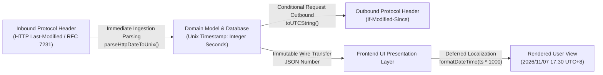

As a hybrid application engineered to run both on Cloudflare Workers edge network (Serverless) and dedicated standalone hosts (VPS/Docker Serverfull), DNS Worker enforces rigorous design and coding standards to preserve data integrity, security, and long-term maintainability.

---

## 1. Architectural & Collaborative Principles

- **Respect Architectural Layering**: Before creating or modifying features, analyze the responsibilities of each layer (DNS pipeline core, network transport ingresses, persistence layer, and Local-First OPFS frontend). Avoid leaking state or introducing tight cross-layer couplings.
- **Minimally Invasive Modifications**: Restrict code changes strictly to the intended feature scope. Retain established naming conventions, code layout, and architectural idioms. Avoid non-essential global refactorings.
- **Modularity & Single Responsibility**: Functions and modules should be pure, cohesive, and isolated. Complex business logic (such as AdGuard parsing, Bloom compilation, and key derivation) must reside in dedicated utility or service modules rather than route handlers.

---

## 2. Code Standardization & Strict Typing

- **Strict Typing Across All Layers**:
  - Explicitly define interfaces, types, and return types for all functions and data contracts in TypeScript.
  - **Never use `any`**, and do not rely on implicit type inference to bypass compilation type safety.
- **Unified Naming Conventions**:
  - Variables & Functions: `camelCase` (e.g., `listFetcher`, `parseHttpDateToUnix`).
  - Classes, Interfaces, Types, Components: `PascalCase` (e.g., `ListModel`, `ListsTable`, `SingleListSyncResult`).
  - Constants & Enums: `UPPER_SNAKE_CASE` (e.g., `DEFAULT_MAX_LIST_BYTES`, `APP_VERSION`).
- **Defensive Programming**:
  - All external network I/O, DNS upstream responses, user inputs, and database interactions must be guarded with comprehensive `try/catch` blocks, null-boundary checks, and format validation.
  - Implement exponential backoff and transient retry handling for network layer flakiness (e.g., TLS renegotiation drops or transient upstream 5xx errors).

---

## 3. Timestamp Standardization (统一时间戳模型规范)

To eliminate timezone ambiguities, string parsing overhead, and localization mismatches, DNS Worker mandates an integer Unix timestamp architecture:

### Core Requirements:
1. **Integer Unix Timestamp in Seconds**:
   - All database columns (`created_at`, `updated_at`, `last_synced_at`, `global_list_metadata.last_modified`), backend domain models, and internal REST/WebSocket schemas **MUST strictly store and transfer time as integer Unix timestamps in seconds** (SQLite `INTEGER` / TypeScript `number`, based on `Math.floor(Date.now() / 1000)`).
   - **Never store formatted text dates** (such as ISO-8601 strings, RFC 2822, or HTTP dates) in database columns or domain models.
2. **Boundary Parsing & Dynamic Serialization**:
   - Inbound protocol dates (such as RFC 7231 `Last-Modified` headers from external filter blocklist servers) must be parsed into integer Unix timestamps immediately at the ingestion boundary before persisting.
   - Outbound conditional requests (such as `If-Modified-Since`) are dynamically serialized to standard RFC dates by the transport layer on demand.
3. **Deferred Presentation-Layer Formatting**:
   - Converting timestamps to human-readable text (e.g., `2026/11/07 17:30:00`), calculating relative freshness, and adjusting for user-configured timezones (`user.timezone`) is **strictly confined to the UI presentation layer** (e.g., `formatDateTime(new Date(timestamp * 1000))`).

---

## 4. Append-Only Database Migration Philosophy

Because the database schema must operate seamlessly across Cloudflare D1, Turso libSQL, and standalone SQLite servers, migrations adhere to an immutable append-only lifecycle:

- **Past Migrations Are Immutable**:
  - Once merged or deployed to production, existing migration files (`migrations/0000_*.sql` through existing sequence numbers) must never be modified directly.
- **Schema Evolutions Require New Numbered Migrations**:
  - Any schema change (adding columns, index refactoring, or column type standardization) must be introduced via a newly incremented migration script (e.g., `0066_standardize_last_modified_timestamp.sql`).
- **Table Recreation Best Practices in SQLite**:
  - When altering column affinities or primary keys in SQLite, follow the canonical table recreation pattern:
    1. Create a new table with the target schema (e.g., `global_list_metadata_new`);
    2. Copy and sanitize data from the old table into the new table;
    3. `DROP TABLE` the old table and rename the new table.
- **Embedded Migrations Synchronization**:
  - After creating any SQL migration file, run `npm run db:generate-migrations` to synchronize `src/lib/turso/embeddedMigrations.ts` for serverless environments lacking filesystem access.

---

## 5. Security Architecture & Defensive Design

- **SSRF Prevention**:
  - All URLs supplied by users or administrators (such as upstream DoH endpoints and blocklist sources) must pass `isSafeUrlWithDnsCheck`. Private IP ranges (RFC 1918), loopback interfaces, link-local addresses, and cloud provider metadata IPs (`169.254.169.254`) are unconditionally blocked.
- **Protocol Compliance & Strict Minimum HTTP Version (RFC 8484 §5.2)**:
  - DoH endpoints and upstream clients strictly enforce **HTTP/2 as the minimum HTTP version**. HTTP/1.1 negotiation is forbidden per RFC 8484 §5.2 ("Clients and servers MUST NOT negotiate HTTP/1.1 for DoH").
  - In Serverfull mode, the HTTPS server natively negotiates ALPN `h2` via `http2.createSecureServer`, and incoming DoH requests over HTTP/1.1 are rejected with `HTTP 505 (HTTP Version Not Supported)`.
  - When upstream DoH queries encounter errors, the exact upstream status and diagnostic response snippet are surfaced transparently to the user without silent or unauthorized protocol downgrades.
- **Post-Quantum Zero-Knowledge Privacy**:
  - Audit logs and analytics payloads are protected via post-quantum cryptography (ML-KEM-768) and envelope encryption (AES-256-GCM). The server stores only ciphertext; private keys are held solely by client devices via WebAuthn / Passkeys.

---

## 6. Test-Driven Mindset & Quality Assurance

- **Automated Verification Before Delivery**:
  - Any alteration to transports, caching, AdGuard rules, Bloom filter chunking, or data schemas must be accompanied by comprehensive unit and integration tests.
- **Standard Verification Suite**:
  - Before committing, verify the following test suites pass:
    - `npm test`: JWT secret and envelope encryption compatibility;
    - `npm run test:global-lists`: Global blocklist deduplication, HTTP 304 caching, and integer timestamp validation;
    - `npm run test:distribute-filter`: Admin filter distribution and user isolation;
    - `npm run test:serverfull`: Serverfull daemon multi-protocol integration (UDP / DoT / HTTPS / RTR);
    - `npx tsc --noEmit` & `npm run build`: Full TypeScript type check and production bundle compilation.
