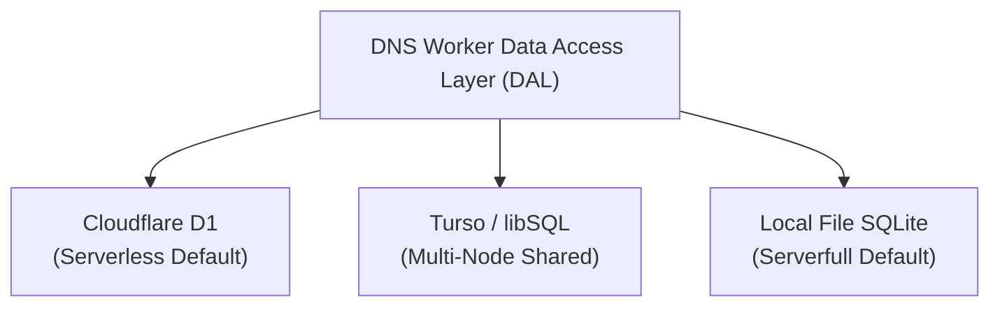

DNS Worker features a unified Data Access Layer (DAL) abstraction, supporting **three distinct database storage engines** across Cloudflare 300+ global edge locations, self-hosted Linux VPS servers, Docker containers, and hybrid distributed setups.



---

## 1. Storage Modes Comparison Matrix

| Dimension / Mode | ☁️ Mode 1: Cloudflare D1 | 🌐 Mode 2: Turso / libSQL | 🖥️ Mode 3: Local File SQLite |
|---|---|---|---|
| **Environment Variable** | `DATABASE_SERVICE="D1"` | `DATABASE_SERVICE="Turso"` | `DATABASE_SERVICE="File"` |
| **Target Runtime** | Cloudflare Workers Edge | **Cross-Platform Universal** (Workers + VPS) | Linux / VPS / Docker / Windows |
| **Storage Medium** | Edge-managed distributed SQLite | libSQL Cloud cluster / self-hosted sqld | Local physical NVMe / SSD disk |
| **Transport Protocol** | In-process Workers context binding | HTTPS / WebSocket (Hrana protocol) | Native VFS file I/O (`node:sqlite`) |
| **Multi-Node Sync** | Cloudflare internal replication | **Strong Real-Time Sync** (Workers & VPS share one DB) | Single host isolated |
| **Outbound Requests** | None (in-process binding) | Outbound HTTPS queries to Turso endpoint | None (zero network traffic) |
| **Schema Migrations** | Executed via `wrangler d1 migrations` | **Auto-applied idempotently on startup/request** | **Auto-applied idempotently on startup** |
| **Operational Effort** | Zero server maintenance | Minimal (Cloud DB instance) | Zero external dependencies |

---

## 2. Mode 1: Cloudflare D1 Distributed Database

Cloudflare D1 is Cloudflare's native serverless SQL database built on SQLite, co-located within the same edge data center running your Worker.

### Best For
* Standalone serverless DoH deployments running entirely on Cloudflare infrastructure;
* Zero-maintenance high availability out-of-the-box;
* Environments relying solely on Cloudflare Workers and standard free tier quotas.

### Setup & Configuration

#### 1. Create D1 Database
Run Wrangler CLI in your terminal (or create via Cloudflare Web Dashboard):
```bash
# Create production D1 database
npx wrangler d1 create dns_worker_db
```
The CLI will output the database name and a unique `database_id` (UUID format).

#### 2. Configure `wrangler.toml`
Add the D1 database binding in `wrangler.toml`:
```toml
[[d1_databases]]
binding = "DB"
database_name = "dns_worker_db"
database_id = "xxxxxxxx-xxxx-xxxx-xxxx-xxxxxxxxxxxx"
migrations_dir = "migrations"
```

#### 3. Execute Migrations

:::note[Initial Migration Required]
You must apply schema migrations upon initial deployment to initialize user tables, access points, and logging schemas.
:::

```bash
# Local development environment migration
npm run db:migrate:dev

# Remote production Cloudflare D1 migration
npm run db:migrate:prod
```

#### 4. Environment Variable Configuration (Optional)
When running on Cloudflare Workers without `DATABASE_SERVICE` specified, the system automatically defaults to `D1`. You may also explicitly define it:
```toml
[vars]
DATABASE_SERVICE = "D1"
```

---

## 3. Mode 2: Turso / libSQL Cloud Database

Turso is a distributed database powered by **libSQL** (the modern open-source evolution of SQLite), delivering fast HTTP and WebSocket queries via the lightweight Hrana pipeline protocol.

### Core Value: Unified Multi-Node Synchronization
If you deploy **both Cloudflare Workers edge instances and one or more self-hosted VPS (Serverfull) instances**:
* D1 cannot be accessed from outside Cloudflare Workers;
* Local SQLite files are strictly bounded to individual VPS disks;
* **Turso bridges this gap completely**: whether queries hit your Hong Kong VPS, Frankfurt VPS, or Cloudflare Anycast edge, all nodes query and write to the same Turso database in real-time, providing **unified user accounts, synchronized custom rules, shared access points, and consolidated query analytics**.

### Setup & Configuration

#### 1. Create a Turso Database
1. Install Turso CLI:
   ```bash
   curl -sSfL https://get.tur.so/install.sh | bash
   ```
2. Authenticate and create a database instance:
   ```bash
   turso auth login
   turso db create dns-worker-db
   ```
3. Retrieve the database URL:
   ```bash
   turso db show dns-worker-db --url
   # Example output: libsql://dns-worker-db-yourorg.turso.io
   ```
4. Generate a persistent Auth Token:
   ```bash
   turso db tokens create dns-worker-db
   # Outputs a JWT authentication token
   ```

#### 2. Configure Cloudflare Workers with Turso
In `wrangler.toml`:
```toml
[vars]
DATABASE_SERVICE = "Turso"
TURSO_DATABASE_URL = "https://dns-worker-db-yourorg.turso.io"
```

Store your Auth Token as an encrypted secret:
```bash
npx wrangler secret put TURSO_AUTH_TOKEN
# Paste your generated token
```

#### 3. Configure Standalone Server / VPS (Serverfull) with Turso
In `/etc/dns-worker/.env` (or local `.env`):
```ini
DATABASE_SERVICE=Turso
TURSO_DATABASE_URL=libsql://dns-worker-db-yourorg.turso.io
TURSO_AUTH_TOKEN=eyJhbGciOiJFZERTQTEw...your_token
```

Restart your service or binary:
```bash
sudo systemctl restart dns-worker
# or
dns-worker start
```

:::tip[Automatic Schema Migrations]
Unlike D1, Turso mode **does not require manual migration execution**. DNS Worker includes an automated, idempotent migration runner that inspects the remote database schema on startup or upon the first incoming request, seamlessly creating and upgrading missing tables.
:::

#### 4. Self-Hosted sqld Alternative
For air-gapped or self-hosted requirements, you can run the open-source `tursodatabase/sqld` daemon via Docker on your private network:
```bash
docker run -d \
  --name sqld \
  -p 8080:8080 \
  -v /data/sqld:/var/lib/sqld \
  -e SQLD_AUTH_JWT_KEY="your_public_key" \
  tursodatabase/sqld:latest
```
Set `TURSO_DATABASE_URL="http://your-sqld-host:8080"` in DNS Worker to operate entirely on private infrastructure.

---

## 4. Mode 3: Local File SQLite Database

For deployments prioritizing total data sovereignty, zero cloud reliance, and offline capability, DNS Worker includes a high-performance local SQLite storage engine.

### Architectural Highlights
* **Zero External Dependencies**: Operates on the Node.js standard library module `node:sqlite` (built into Node.js `>= 22.5.0` and Bun `>= 1.4.0`);
* **High-Throughput Disk I/O**: Configured with `PRAGMA journal_mode = WAL;` and `PRAGMA synchronous = NORMAL;`, offering strong concurrent read/write throughput and crash resiliency;
* **Complete Privacy**: All query logs and credentials reside in a single local `.sqlite` file on your private NVMe disk.

### Default Persistent Paths
* **Linux / systemd**: `/var/lib/dns-worker/dns_worker.sqlite`
* **Windows**: `%ProgramData%\DNS-Worker\dns_worker.sqlite`

### Setup & Configuration

#### 1. Standard Environment Configuration (`.env`)
In `/etc/dns-worker/.env`:
```ini
DATABASE_SERVICE=File

# Optional: Override default database storage path
SERVERFULL_DB_PATH=/var/lib/dns-worker/dns_worker.sqlite
```

#### 2. Docker Container Persistent Volume
When running in Docker, mount the database directory to maintain state across container restarts:
```bash
docker run -d \
  --name dns-worker \
  --restart unless-stopped \
  -p 53:53/udp \
  -p 853:853/tcp \
  -p 10080:10080/tcp \
  -p 10443:10443/tcp \
  -v /var/lib/dns-worker:/var/lib/dns-worker \
  -v /etc/dns-worker:/etc/dns-worker \
  ghcr.io/obein/dns-worker:latest
```

#### 3. Backup and Disaster Recovery
Backing up local SQLite state is straightforward:
```bash
# Online hot backup using sqlite3 CLI
sqlite3 /var/lib/dns-worker/dns_worker.sqlite ".backup /backup/dns_worker_$(date +%Y%m%d).sqlite"

# Or copy during maintenance (ensure -wal and -shm files are captured)
cp /var/lib/dns-worker/dns_worker.sqlite /backup/
```

---

## 5. Engine Resolution Priority & Auto-Detection

When DNS Worker starts, the database engine is determined by `getDatabaseService(env, isServerfull)`:

1. **Explicit Priority**: If `DATABASE_SERVICE` (or `DB_SERVICE`) is explicitly defined (`D1`, `Turso`, `File`, case-insensitive), it overrides all defaults;
2. **Credential Inference**: If `DATABASE_SERVICE` is omitted, but valid `TURSO_DATABASE_URL` and `TURSO_AUTH_TOKEN` are present, the system **automatically enables Turso mode**;
3. **Platform Default**:
   * Cloudflare Workers falls back to `D1`;
   * Serverfull (Node.js/Bun/Docker) falls back to `File`.

---

## 6. Troubleshooting & Compatibility

:::caution[Platform Constraints]
* **`DATABASE_SERVICE="File"` is not supported on Cloudflare Workers**: Cloudflare Workers is a stateless serverless environment without persistent block storage.
* **`DATABASE_SERVICE="D1"` is not supported on Standalone VPS (Serverfull)**: D1 is proprietary Cloudflare Workers storage; use `File` or `Turso` on standalone servers.
:::

### 1. Turso Connection Timeout or SSL Error
* **URL Protocol**: DNS Worker automatically handles both `libsql://` and `https://` protocols. If you encounter handshake issues on Workers, prefer specifying `https://...`.
* **Expired Auth Token**: Verify your token validity using `turso db tokens create`. If you receive a `401 Unauthorized` error, generate a new token.

### 2. Linux File Permission Denied (`EACCES`)
* When running as a non-root system user, ensure the data directory is writable:
  ```bash
  sudo mkdir -p /var/lib/dns-worker
  sudo chown -R $USER:$USER /var/lib/dns-worker
  sudo chmod 755 /var/lib/dns-worker
  ```

### 3. Inspecting Database Status
Check current database status and disk usage from the command line:
```bash
dns-worker status
```
The output displays the active database provider (`File`, `Turso`), database path, file size, and record counts.
