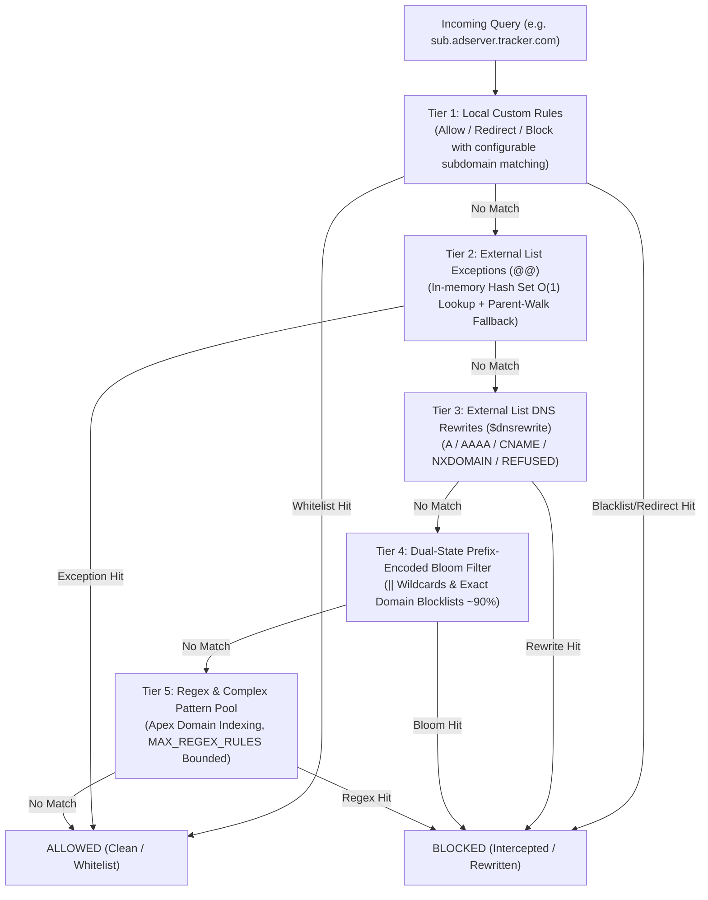

import { Image } from 'astro:assets';
import filterImg from '../../../../screenshots/dns.obex-filter.webp';
import rulesImg from '../../../../screenshots/dns.obex-rules.webp';
import logImg from '../../../../screenshots/dns.obex-log.webp';
import logDetailImg from '../../../../screenshots/dns.obex-log_detail.webp';

DNS Worker features an enterprise-grade protective domain filtering engine capable of evaluating hundreds of thousands of blocking rules with sub-millisecond latency. It shields your network and client devices against intrusive advertisements, telemetry trackers, malware, phishing sites, cryptojacking, and malicious command-and-control (C2) domains.

---

## 1. Threat Defense & Protection Capabilities

DNS Worker intercepts cyber threats at the foundational DNS layer—preventing connections before TCP handshakes or TLS negotiations even occur.

### Protected Threat Categories
- **Malicious Domains & Malware**: Blocks command-and-control (C2) servers, trojan distribution endpoints, botnets, and ransomware callback domains.
- **Phishing & Fraud**: Neutralizes fraudulent financial portals, credential harvesting pages, and impersonation domains.
- **Intrusive Advertising & Trackers**: Silently terminates banner ads, popups, video ad servers, and cross-site telemetry beacons across all mobile apps and websites.
- **Operating System & Device Telemetry**: Stops aggressive diagnostic data collection from Windows, macOS, Android, smart TVs, and IoT appliances.
- **Cryptominers**: Blocks in-browser and background cryptocurrency mining scripts.

---

## 2. Web UI Filter Rule Management

### Subscribing to External Blocklists

Navigate to **Filters** (规则订阅) in the Web Dashboard to inspect and manage your blocklist subscriptions.

<Image src={filterImg} alt="Filter Subscriptions & Blocklists" format="webp" />

1. Under **External Blocklists**, click **Add Subscription**.
2. Enter the subscription URL (supports standard Adblock Plus, Hosts, or domain list formats).
3. Popular pre-tested lists include:
   - **OISD Big**: `https://big.oisd.nl` (comprehensive baseline ad & tracking protection)
   - **AdGuard Base**: `https://adguardteam.github.io/HostlistsRegistry/assets/filter_1.txt`
   - **HaGeZi Multi PRO++**: `https://raw.githubusercontent.com/hagezi/dns-blocklists/main/adblock/pro.plus.txt` (aggressive threat defense)
   - **StevenBlack Unified**: `https://raw.githubusercontent.com/StevenBlack/hosts/master/hosts`
4. Click **Save & Sync**. DNS Worker parses the rules into optimized memory buffers and updates subscription metadata:
   - **Domain Count**: Displays total parsed unique domain rules (e.g. 100,000+).
   - **Status Badges**: Shows `Normal` (synchronized), `Outdated` (sync pending), or `Missing` (download failed).
   - **Staggered Full Sync**: Manual "Sync All" runs sequentially with a 1-second delay between lists to prevent CPU bursts and database locking.
   - **Individual List Sync**: Manually trigger synchronization for a specific subscription from its "List Details" dialog, automatically recombining profile rules upon completion.
   - **Automated Cron Sharding**: Background cron workers shard rule downloads across scheduled intervals (one list per minute), distributing edge resource consumption.

---

### Profile-Level, User-Level & System-Level Filter Lists

To balance **centralized administrative governance** with **personalized granular control** across diverse devices, endpoints, and users, DNS Worker introduces a structured three-tier filter list architecture:

| Tier | Management Portal | Scope | Badge | Per-Profile Toggle | Independent Deletion |
| :--- | :--- | :--- | :--- | :--- | :--- |
| **Profile-Level** | `/filter` (Upper section) | Applies exclusively to the active profile | *None* | Supported | Supported |
| **User-Level** | `/account` (User Filter Lists) | Inherited automatically by all profiles of the user | **User** (Green Tag) | Supported (Profile override) | `/account` page only |
| **System-Level** | `/account` (System Filter Lists - Admin) | Distributed globally to all users and all profiles | **System** (Blue Tag) | Supported (Profile override) | Admin revocation only |

#### 1. Core Architecture Tiers
- **Profile-Level Lists**: Dedicated to a single profile. Added, synced, toggled, and deleted directly within `/filter`. Ideal for isolated policies (e.g. strict parental control lists on kids' devices, or minimal lightweight rules for server endpoints).
- **User-Level Lists**: Shared across a user account. Managed once on the `/account` page and automatically inherited by every profile under that user. Eliminates the need to duplicate common personal blocklists across multiple endpoints.
- **System-Level Lists**: Organization or platform security baselines. Distributed by administrators to all user accounts to enforce global threat intelligence (such as malware, phishing, and ransomware blocklists). Administrators can revoke distributed rules at any time, which purges the system-tagged list without affecting users' custom lists.

#### 2. `/filter` Multi-Tier Layout & Controls
Within each profile's `/filter` view, lists are organized in a split layout:
- **Upper Section (Profile Lists)**: Displays profile-specific rules with full management capabilities (add, sync, toggle, delete).
- **Divider**: Clearly delineates profile-specific rules from inherited global rules.
- **Lower Section (User & System Lists)**: Displays inherited user-level and system-level lists with corresponding `User` or `System` badges:
  - **Per-Profile Toggling**: Users can selectively disable or enable any user or system list for the current profile via profile override mappings (`profile_user_list_overrides`), without affecting other profiles.
  - **Protected From Profile-Level Deletion**: To maintain global configuration integrity, delete buttons are hidden for inherited lists in the profile view. User lists must be managed from `/account`, while system lists are controlled by administrators.

#### 3. Duplicate Handling & Linked Toggles
- **Duplicate URLs Allowed**: The same subscription URL can coexist across profile-level, user-level, and system-level tiers.
- **Linked Disabling**: When a user disables a filter list in a profile, if duplicate entries with the same URL exist across tiers, the system **simultaneously disables all matching entries** in that profile. This prevents deceptive states where a list appears disabled while identical rules remain active through another tier. Re-enabling affects only the individually toggled item.
- **Deduplicated Engine Compilation**: When compiling active rules into Bloom filters and regex sets, the background synchronization pipeline automatically deduplicates active URLs (`Set<string>`). Identical URLs are fetched and parsed only once, minimizing network egress and edge compute overhead.

---

### Custom Allowlist, Blocklist & Rewrites

Navigate to **Rules** (自定义规则) to configure instant manual overrides on a per-profile basis:

<Image src={rulesImg} alt="Custom Rules Management" format="webp" />

- **Allowlist (白名单)**: Domains that bypass all blocking rules (e.g., corporate subdomains or false positives).
- **Blocklist (黑名单)**: Explicitly banned domains that take immediate precedence over external lists.
- **DNS Rewrites (重写 / 重定向)**: Maps custom domains to specific IP addresses or local services (e.g., intranet services or SafeSearch enforcement like `forcesafesearch.google.com`).
- **Subdomain Matching Policy**: Replaced standalone toggle with wildcard patterns. To match subdomains, use the wildcard `*.example.com`; `example.com` will only match the exact domain.
- **Supported Syntax**:
  - Plain domains: `ad.example.com`
  - Subdomain wildcards: `*.tracking.company.com` or `||adservice.google.com^`
  - Regular expressions: `^analytics-[0-9]+\..*$`

---

### Block Action Modes

In your profile settings, select how blocked queries are handled:

| Block Mode | Response Behavior | Advantages |
| :--- | :--- | :--- |
| **Zero IP (0.0.0.0 / ::)** | Returns `0.0.0.0` for IPv4 and `::` for IPv6 | **Recommended**. Fastest client termination, prevents timeout retries. |
| **NXDOMAIN** | Returns RCODE 3 (Domain Not Found) | Standards-compliant, signals client that the domain does not exist. |
| **Refused** | Returns RCODE 5 (Query Refused) | Distinguishes blocked requests from non-existent domains. |

---

## 3. Real-Time Threat Audit & Query Logs

DNS Worker provides instant visibility into intercepted threats and permitted resolutions through the **Logs** view:

<Image src={logImg} alt="Real-Time Query Logs & Threat Interception" format="webp" />

- **Instant Visual Status**:
  - `BLOCK` (Red): Queries intercepted by external blocklists or custom blacklist rules. Displays the synthetic block answer (`0.0.0.0`).
  - `PASS` (Green): Legitimate queries forwarded to upstream resolvers and successfully answered.
  - `REWRITE` (Blue): Queries mapped to custom redirect targets.
- **Threat Audit Drawer**: Clicking on any query entry slides out the inspection drawer, detailing the exact rule match, client IP, geographic origin, upstream latency, and post-quantum encryption status.

<Image src={logDetailImg} alt="Query Log Inspection Drawer" format="webp" />

---

## 4. Match Engine Architecture: Tiered Hybrid Architecture

To maintain high throughput on lightweight environments (such as VPS instances with 512MB RAM or Cloudflare Workers edge nodes with 128MB memory caps) while natively supporting full AdGuard Home filtering rules, DNS Worker uses a **high-performance tiered hybrid architecture**:

1. **Short-Circuit Cascade Evaluation**:
   - **Tier 1: Local Custom Rules**: Highest priority. Evaluates user-defined rules with configurable exact-domain or subdomain matching.
   - **Tier 2: External List Exceptions (`@@`)**: Maintained as an in-memory hash set (`Set<string>`) with $O(1)$ direct lookup followed by parent-domain label traversal. Matches short-circuit directly to `PASS`, entirely eliminating false-positive risks from downstream Bloom filters.
   - **Tier 3: External List DNS Rewrites (`$dnsrewrite`)**: Synthesizes custom DNS answers (A, AAAA, CNAME) or custom status codes (NXDOMAIN, REFUSED).
   - **Tier 4: Dual-State Prefix-Encoded Bloom Filter**: The primary defense line for millions of static blocklist entries. Distinguishes exact domain entries from wildcard domain entries with the `||` prefix, executing in microseconds and preventing single-domain rules from incorrectly intercepting subdomains.
   - **Tier 5: Regex & Complex Pattern Pool**: Evaluates `/regex/` and complex wildcards with inverted apex-domain indices, narrowing regex evaluation scope. Bounded by a default cap of 1,000 patterns per profile.

---

## 5. Filtering Environment Variables Reference

Configure these variables in `.env` (Serverfull) or `wrangler.toml` (Cloudflare Workers).

### `MAX_REGEX_RULES`
- **Supported in**: Serverless & Serverfull
- **Default**: `1000`
- **Description**: Maximum number of merged AdGuard regular expression and complex wildcard rules permitted per profile. Excess patterns are safely discarded with warning logs to preserve sub-millisecond DNS lookup performance.

### `PRESET_EXTERNAL_FILTERS`
- **Supported in**: Serverless & Serverfull
- **Format in `wrangler.toml`**: Multi-line TOML string containing a JSON array of `{ label, url }` objects.
- **Format in `.env.serverfull`**: JSON string.
- **Default**: Curated default subscriptions including OISD Big (`https://big.oisd.nl`), OISD NSFW, AdGuard Base, and StevenBlack hosts.

### `BLOOM_FALSE_POSITIVE_RATE`
- **Supported in**: Serverless & Serverfull
- **Default (`wrangler.toml`)**: `0.0001` (1 in 10,000)
- **Default (`.env.serverfull`)**: `0.0001`
- **Description**: Configures bitset size calculation for Bloom filters. The lower threshold (0.0001) minimizes false positives and eliminates CPU spikes during rule evaluation.

### `MAX_SYNC_DOMAINS`, `MAX_LIST_DOMAINS` & `MAX_LIST_BYTES`
- **Supported in**: Serverless & Serverfull
- **Defaults**: `MAX_SYNC_DOMAINS=1000000` (1 million total), `MAX_LIST_DOMAINS=500000` (500k per list), & `MAX_LIST_BYTES=20971520` (20 MB per list).
- **Description**: Safety boundaries to prevent unbounded memory allocation and excessive network downloads during external filter fetching. If a list exceeds `MAX_LIST_BYTES`, it is safely parsed up to the limit and marked with a truncation warning in sync status.

### `BLOOM_MEM_TTL` & `SYNC_TIMEOUT_MS`
- **Defaults**: `BLOOM_MEM_TTL=600000` (10 minutes in-memory cache) & `SYNC_TIMEOUT_MS=30000` (30s download timeout).
- **Description**: Cache retention time for compiled bloom filters in memory and maximum network timeout when downloading upstream blocklists.

### `CONFIG_MEM_TTL`
- **Supported in**: Serverless & Serverfull
- **Default**: `300000` (5 minutes)
- **Description**: How long each Worker isolate keeps a profile's settings and rules in memory. The Cache-Tag purge (`CF_ZONE_ID` / `CF_PURGE_TOKEN`) clears the cached copy in every data center, but not the in-memory copy held by other isolates, so this value bounds how long a settings change can take to apply everywhere. Lowering it (e.g. `60000`) is cheap: a re-read is normally served from the Cache API rather than the database.

### `SUBSTITUTE_DOMAIN`
- **Supported in**: Serverless & Serverfull
- **Default**: `www.okx.com`
- **Description**: Probing domain used for latency benchmarking and fail-open detection against upstreams.

### `BLOCK_MODE`
- **Supported in**: Serverless & Serverfull
- **Default**: `zero_ip` (`0.0.0.0` / `::`)
- **Options**: `zero_ip`, `nxdomain`, `refused`
- **Description**: Global fallback blocking behavior when not overridden in per-profile settings.
