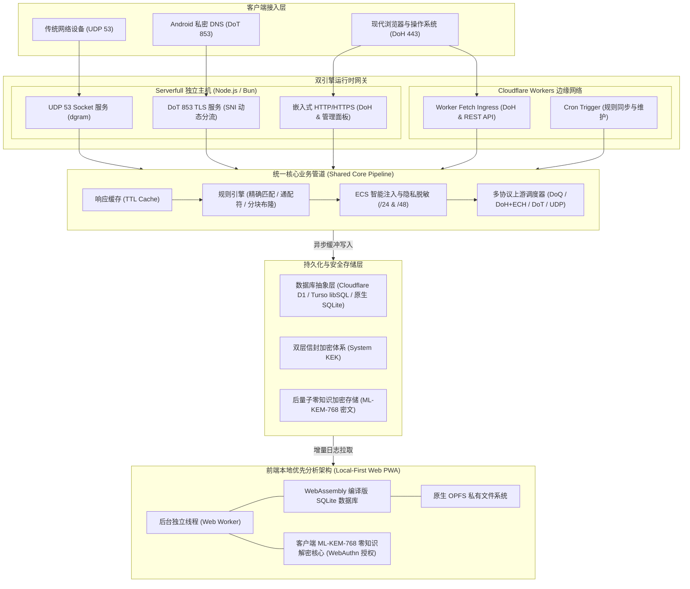
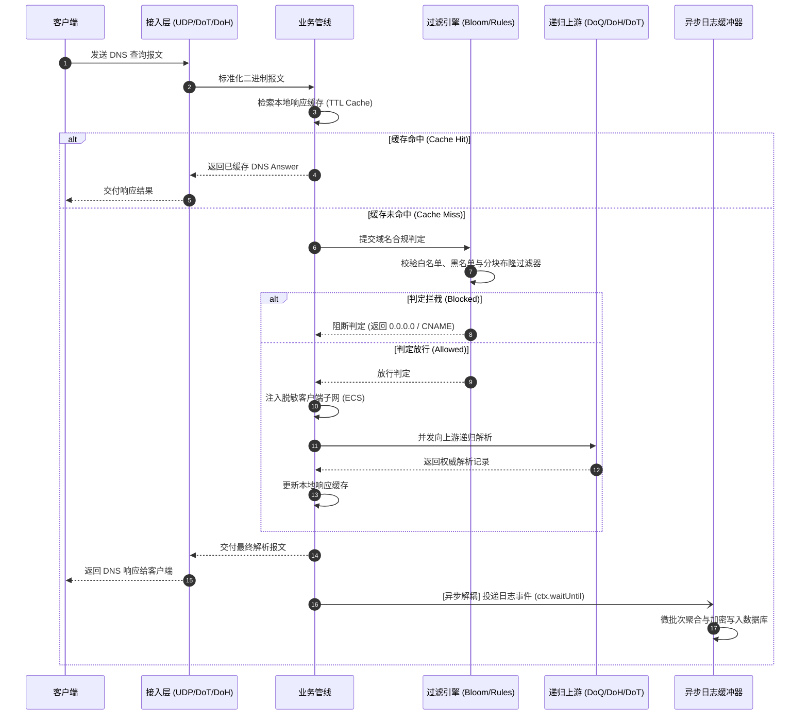
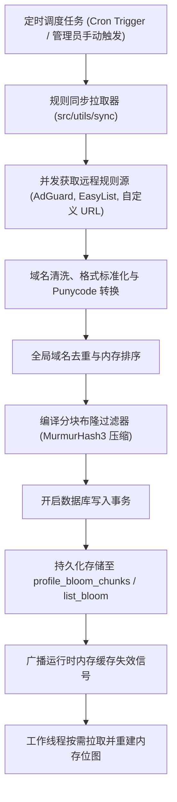
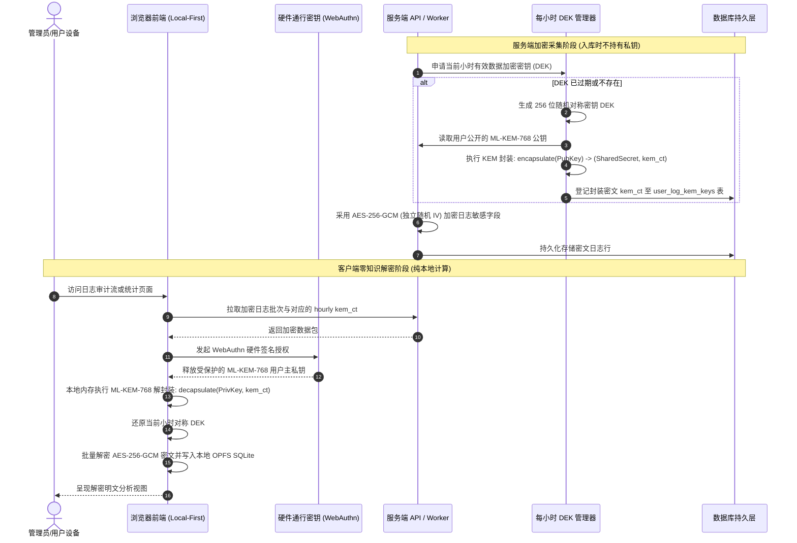
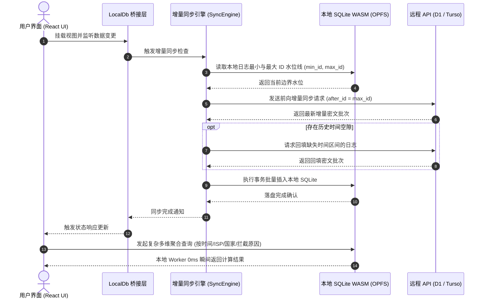

DNS Worker 采用统一业务内核与双运行时引擎架构，支持在 Cloudflare Workers 边缘网络以 Serverless 模式运行，或在独立服务器/VPS 以 Serverfull 守护进程模式运行。系统覆盖 DNS 全协议栈解析、分块布隆规则过滤、后量子端到端加密（PQC E2EE）以及前端本地优先（Local-First OPFS）数据分析。

---

## 架构拓扑

系统通过运行时环境适配层，将同一套核心解析管道部署于边缘无服务器计算环境与独立主机环境。

### 双引擎统一拓扑



---

### 代码工程结构

项目代码按职责划分为核心运行时、前端交互界面、数据库版本迁移与自动化测试套件：

```text
ObexDNS/
├── src/                               # 核心后端逻辑（Serverless 与 Serverfull 共享）
│   ├── index.ts                       # Cloudflare Workers 入口与计划任务调度
│   ├── api/                           # RESTful 与 WebSocket API 路由分层
│   │   ├── auth/                      # 认证子模块（Turnstile 验证、锁定屏、密码找回）
│   │   ├── account/                   # 账户管理（个人资料、安全凭据、WebAuthn、E2EE 设置）
│   │   ├── profiles/                  # 接入点配置、规则集配置、审计日志及实时 WebSocket 流
│   │   ├── doh.ts                     # RFC 8484 DoH 标准请求处理器
│   │   └── system.ts                  # 系统设置与状态端点
│   ├── pipeline/                      # DNS 解析管线核心（缓存、过滤判定、ECS 注入、上游调度）
│   ├── models/                        # 数据访问层与实体模型（Profile、Rule、List、KEM Key、Session 等）
│   ├── lib/                           # 核心安全与数据库适配库
│   │   ├── turso/                     # Turso / libSQL Hrana v2 协议适配层
│   │   ├── crypto/                    # 密码学套件与每小时 KEM DEK 动态轮换管理
│   │   └── webauthn/                  # FIDO2 / WebAuthn 挑战与验签
│   ├── serverfull/                    # 独立服务器守护进程（UDP 53、DoT 853、嵌入式 HTTP、CLI 与系统服务）
│   └── utils/                         # 工具库（DNS 编解码、ECH 编解码、规则拉取清洗、布隆编译器等）
│
├── web/                               # 本地优先前端单页面应用 (React + TypeScript + Vite)
│   ├── src/views/                     # 业务视图组件（仪表盘、日志流、规则管理、接入点配置、系统设置）
│   ├── src/services/localDb/          # 本地优先 SQLite 领域服务体系（Worker 通信、增量同步、分析查询、存储维护）
│   ├── src/workers/                   # 后台 Web Worker（承载 SQLite WASM 与 OPFS 驱动）
│   └── src/crypto/                    # 浏览器端 NIST FIPS 203 ML-KEM-768 解密核心
│
├── migrations/                        # 版本化 SQL 数据库结构迁移脚本
└── test/                              # 自动化测试矩阵（Turnstile 门控、Turso 协议、Serverfull 守护进程集成测试）
```

---

## 系统分层与组件设计

DNS Worker 在逻辑架构上解构为五大垂直层级：

### 1. 多协议网络接入层

负责将异构传输协议的输入报文统一标准化为二进制 DNS 报文（DNS Message）：

- **UDP 53 接入组件 (`src/serverfull/udp.ts`)**：基于 Node.js 原生 `dgram` 套接字绑定 `53` 端口，采用无锁二进制切片直接读取报文头部，内置滑动窗口速率限制防御 DNS 反弹放大攻击。
- **DoT 853 接入组件 (`src/serverfull/dot.ts`)**：基于原生 `tls` 模块监听 `853` 端口，处理 RFC 7858 两字节长度前缀分包，并在 TLS 握手阶段动态提取 SNI 路由接入点（`<profileKey>.dns.example.com`），实现 Android 原生私密 DNS 接入多租户分流。
- **DoH / HTTP 接入组件 (`src/api/doh.ts`, `src/serverfull/http.ts`)**：实现标准 RFC 8484 规范（支持 GET Base64URL 与 POST 二进制 Payload），支持 HTTP/2 与 HTTP/3，并在响应中动态注入包含公钥标识与参数的 RFC 9460 HTTPS / SVCB 资源记录以支持 ECH（加密客户端 Hello）。

### 2. 规则引擎与布隆分发层

负责对解析请求进行合规审计与拦截判定：

- **三级级联过滤判定链**：
  1. **白名单优先绕过**：匹配自定义白名单域名，命中直接放行。
  2. **精确与通配符规则匹配**：基于倒排域名树和 Hash 表实现对自定义规则的亚微秒匹配。
  3. **分块分层布隆过滤器**：针对收录数十万至数百万域名的开源规则集，通过 MurmurHash3 算法将其压缩为多组轻量级分块位图（每块 256KB~1MB），保持 0 假阴性且假阳性低于 0.1%，内存开销比传统树结构降低 90% 以上。
- **规则同步与编译管道 (`src/utils/sync/`)**：定时拉取外部订阅，执行流式过滤、域名清洗、Punycode 转换与去重，编译完成后分块持久化至数据库。

### 3. 核心解析与上游调度层

负责在域名合规放行后，调度递归解析器获取权威结果：

- **解析管线调度器 (`src/pipeline/index.ts`)**：
  - **响应缓存 (`src/pipeline/cache.ts`)**：维护带 TTL 的自适应缓存，对拦截域名直接合成拦截响应并设置短 TTL，减少冗余请求。
  - **ECS (EDNS Client Subnet) 注入与脱敏 (`src/utils/dns/injectEcs.ts`)**：截断客户端 IP 为 `/24` (IPv4) 或 `/48` (IPv6) 网段信息注入请求，使 CDN 获得就近调度能力的同时隔离客户端精确 IP。
- **多协议并发上游调度**：同时管理 DoQ (`quic://`)、DoH+ECH (`https://`)、DoT (`tls://`) 与传统 UDP/TCP 上游，支持并发竞速（Race）与故障转移熔断机制。

### 4. 数据持久化与存储抽象层

负责提供跨平台统一的数据存取接口与敏感数据保护：

- **统一数据库驱动抽象**：为 Cloudflare D1、Turso / libSQL（通过 Hrana v2 HTTP Pipeline 批量执行与短读缓存）以及本地 `node:sqlite` 提供一致的 `D1Database` 契约。
- **双层系统信封加密 (`src/utils/envelope.ts`)**：通过系统主密钥 `KEK_v1`（兼容 `KEK_v0`），对存储于数据表中的敏感凭证（TOTP 密钥、API Token、Profile Key）在入库前执行 AES-256-GCM 信封加密。
- **异步日志缓冲聚合器 (`src/pipeline/logBatcher.ts`)**：DNS 解析完成后，日志任务直接投递至内存队列，借助 Cloudflare Workers 的 `ctx.waitUntil()` 或 Node.js 异步事件循环在后台微批次合并写入，不占用关键响应链路时间。

### 5. 前端交互与本地优先层

负责将分析计算与日志解密下沉至客户端：

- **WASM SQLite + OPFS 本地存储**：前端在独立的 Web Worker 线程中运行官方 WebAssembly SQLite 数据库，并持久化到 Origin Private File System (OPFS)。
- **本地即时多维分析**：日志全文检索、客户端分布过滤与地理国家流向统计均在本地 Worker 线程毫秒级执行，不消耗云端数据库读配额。
- **客户端后量子零知识解密 (`web/src/crypto/pqc.ts`)**：启用 E2EE 后，服务端仅存储密文；客户端通过 WebAuthn 硬件通行密钥（Passkey）在浏览器内存中解开主私钥，本地还原明文日志。

---

## 数据流与交互机制

### 1. 端到端 DNS 查询与解析流



---

### 2. 规则订阅、编译与布隆分块分发流



---

### 3. 审计日志采集与后量子零知识 E2EE 加密流



---

### 4. 本地优先 (Local-First OPFS) 增量同步与离线查询流


