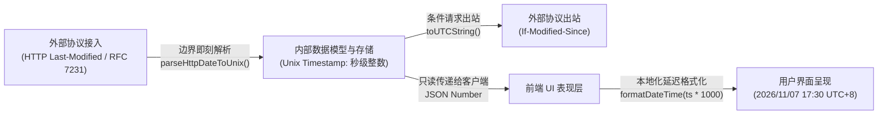

DNS Worker 作为兼顾 Cloudflare Workers 边缘计算（Serverless）与独立服务器/容器（VPS / Docker Serverfull）常驻守护进程的高可用混合架构项目，在代码工程、数据一致性、网络协议合规与隐私安全方面建立了清晰的设计与编码准则。

---

## 规范等级说明

为了在保持工程严谨性的同时赋予开发迭代必要的灵活性，本规范所有条目均标注了明确的等级标签：

| 等级标签 | 适用范围与约束力 | 裁量原则 |
| :--- | :--- | :--- |
| **`【严格】`** | **不可妥协的底线规范**。<br/>直接关乎系统安全边界（如 SSRF、越权）、数据完整性（如破坏迁移版本哈希、存储文本时间造成解析歧义）、协议硬违规（如 RFC 8484 强制最低 HTTP/2）或编译期失效（如滥用 `any` 击穿全链路类型）。 | 原则上从严收敛，仅保留关键底线，代码合并时强行校验，不允许任何豁免。 |
| **`【推荐】`** | **团队核心工程标准与最佳实践**。<br/>涵盖架构分层隔离、模块化解耦、防御性重试、临时表迁移模式及自动化测试覆盖等。 | 绝大多数场景下必须遵守；若因极端性能优化或特定硬件底层限制需要突破，必须在 PR 中提供详尽的技术论证与评审记录。 |
| **`【参考】`** | **工程风格统一与进阶调优建议**。<br/>涵盖命名惯例、人机协作标记（`TODO: [HUMAN]`）、高 QPS 场景下的内存与 GC 调优等。 | 引导代码呈现更高的自解释性与一致体验，鼓励在日常编码与评审中积极采纳。 |

---

## 1. 架构与协同设计原则

### 1.1 尊重现有架构分层 `【推荐】`

* **制定理由**：DNS Worker 需要无缝适配 Cloudflare Workers 无文件系统边缘环境与独立常驻 Node.js 守护进程两种截然不同的运行时，且前端具备 Local-First OPFS 离线与增量同步能力。如果跨层直接读写私有状态、或在 UI 表现层中侵入持久化 SQL 逻辑，将破坏运行时环境的解耦性，并导致数据流产生副作用。
* **正例**：
  ```typescript
  // 表现层仅通过统一抽象的 Service 接口与后端或 Local-First 数据层交互
  import { keepProfileList } from '@/services/profiles';
  await keepProfileList(profileId, listId);
  ```
* **反例**：
  ```typescript
  // 反例：在 React 视图组件内部直接引入底层 Node.js 驱动或试图直接拼装执行 SQL
  import { DatabaseSync } from 'node:sqlite';
  const db = new DatabaseSync('local.db');
  db.prepare('UPDATE lists SET is_system = 0 WHERE id = ?').run(listId);
  ```

### 1.2 极简侵入式修改 `【推荐】`

* **制定理由**：在多人协作与人机协同（AI 编程助手）开发中，严格控制每次变更的代码修改半径，能最大程度保护已有验证逻辑不受波及，极大减少非必要的大范围回归风险，并确保 `git blame` 历史追溯清晰可靠。
* **正例**：在新增“下发规则撤回”特性时，仅在 [`src/models/list.ts`](file:///d:/Coding/OriginalProject/ObexDNS/src/models/list.ts) 增补 `revokeSystemList` 并在对应 API 路由中添加分支，保持既有函数命名习惯与字段定义不变。
* **反例**：在修复一个列表加载小缺陷时，顺手对整个视图组件的数百行无关联代码做重新缩进、变量重命名或重写样式，导致审查时无法快速定位关键改动。

### 1.3 模块化与单一职责 `【推荐】`

* **制定理由**：高内聚、单一职责的纯函数更容易进行隔离的单元测试与性能画像，并且可以安全地在 Cloudflare Workers 和 Node.js 环境之间无缝共享复用。
* **正例**：
  ```typescript
  // 将规则解析逻辑抽取为纯函数模块，不绑定任何特定网络或 HTTP 框架
  export function parseAdGuardLine(line: string): ParsedRule | null {
    // 纯文本解析与规则提取逻辑...
  }
  ```
* **反例**：在 API 请求 Handler 内部同时执行 HTTP Body 解析、规则文件外网下载、逐行正则匹配、Bloom 过滤器二进制位计算以及数据库多表事务更新。

### 1.4 人机协作交接标记 `【参考】`

* **制定理由**：在 AI 协同或多人协作交接时，对需要人工裁决的业务决策、私密凭据配置或生产发布事项进行显式规范化标注，避免自动化流程臆测或遗漏关键配置。
* **正例**：
  ```typescript
  // TODO: [HUMAN] 部署至生产前需在此配置专用的外部 OAuth Client Secret 环境变量
  ```

---

## 2. 编码与严格类型规范

### 2.1 杜绝 `any` 逃逸与隐式类型绕过 `【严格】`

* **制定理由**：TypeScript 编译期静态分析是保障 DNS 协议解析与海量加密日志安全的第一道防线。一旦在关键链路上使用 `any`，TypeScript 将彻底放弃静态推断，类型错误会穿透到运行时，在生产环境下引发不可挽回的 `TypeError: Cannot read properties of undefined`。
* **正例**：
  ```typescript
  export interface RevokeFilterResult {
    canonicalUrl: string;
    revokedProfilesCount: number;
    affectedProfileIds: string[];
    affectedUsernames: string[];
  }
  
  export async function revokeSystemList(url: string): Promise<RevokeFilterResult> {
    // 具备完整的输入与返回类型保障
  }
  ```
* **反例**：
  ```typescript
  // 反例：使用 any 偷懒，调用方无法获得代码提示，字段拼写错误在编译期无法被捕获
  export async function revokeSystemList(url: any): Promise<any> {
    // 隐患潜藏
  }
  ```

### 2.2 显式定义导出实体与函数签名 `【推荐】`

* **制定理由**：公共模块导出的函数入参、返回值类型以及 React 组件 Props 均应显式声明 Interface 或 Type。显式声明形成了可靠的代码契约，避免因依赖编译器深层隐式推断而在依赖演进时引入破坏性变更。
* **正例**：
  ```typescript
  export interface DistributeFilterCardProps {
    toasterRef?: React.RefObject<OverlayToaster | null>;
    onSavingChange?: (saving: boolean) => void;
  }
  
  export const DistributeFilterCard: React.FC<DistributeFilterCardProps> = ({ toasterRef, onSavingChange }) => { ... };
  ```

### 2.3 统一代码命名约定 `【参考】`

* **制定理由**：统一且符合行业惯例的命名法能够让协作者一眼识别标识符的语义、生命周期与作用范围，大幅降低上下文切换与阅读的心智成本。
* **正例**：
  * **变量与普通函数**：采用 `camelCase`（如 `listFetcher`、`parseHttpDateToUnix`）。
  * **类、接口、类型、React 组件**：采用 `PascalCase`（如 `ListModel`、`ListsTable`、`SingleListSyncResult`）。
  * **全局常量与枚举**：采用 `UPPER_SNAKE_CASE`（如 `DEFAULT_MAX_SYNC_DOMAINS`、`APP_VERSION`）。
* **反例**：
  ```typescript
  const default_max_sync_domains = 100000;
  class list_model {
    async Get_List_By_Id(ID: number) { ... }
  }
  ```

### 2.4 网络与外部输入防御性编程 `【推荐】`

* **制定理由**：DNS 解析涉及不可信的上游响应、第三方网络列表与开放网络请求，存在网络闪断、格式畸形、超时与 5xx 异常。全链路必须具备完备的异常捕获、空边界防护与优雅退避，防止单个异常请求拖垮整个工作线程。
* **正例**：
  ```typescript
  try {
    const res = await fetchWithTimeout(url, { timeoutMs: 5000 });
    if (!res.ok) throw new Error(`HTTP ${res.status}`);
    const data = await res.json() as ExpectedPayload;
    return data?.profile?.id ?? null;
  } catch (err) {
    logger.warn(`Failed to fetch from ${url}, fallback to cache:`, err);
    return getCachedFallback();
  }
  ```
* **反例**：
  ```typescript
  // 反例：假定外部上游永远可用且数据永远符合预期
  const data = (await (await fetch(url)).json()).data.items.map(x => x.url);
  ```

---

## 3. 统一时间戳数据模型规范

为了彻底根除时区偏差、国际化文本解析歧义及序列化开销，DNS Worker 确立了系统级的统一时间戳模型：



### 3.1 数据库与领域模型全整型 Unix 时间戳 `【严格】`

* **制定理由**：格式化文本（如 ISO-8601、RFC 2822 等）在底层数据库（SQLite / D1）中占用过多字节，且字符串排序与数值排序不等价，跨时区比较存在严重的解析歧义与时钟偏差。以秒级整型 Unix 时间戳（`Math.floor(Date.now() / 1000)` / SQLite `INTEGER`）作为唯一内部标准，保证了全局高效索引、范围检索零时差和极致轻量。
* **正例**：
  ```sql
  -- 数据表中所有时间字段统一为 INTEGER 秒级整型时间戳
  CREATE TABLE lists (
    id INTEGER PRIMARY KEY,
    last_synced_at INTEGER,
    last_modified INTEGER
  );
  ```
  ```typescript
  const now = Math.floor(Date.now() / 1000);
  await db.prepare("UPDATE lists SET last_synced_at = ? WHERE id = ?").bind(now, listId).run();
  ```
* **反例**：
  ```sql
  -- 反例：直接将格式化日期字符串存入数据表，导致范围查询和索引效率低下
  CREATE TABLE lists (
    id INTEGER PRIMARY KEY,
    last_synced_at TEXT -- 例如 '2026-11-08T03:45:00.000Z'
  );
  ```

### 3.2 外部协议边界即刻解析与动态序列化 `【推荐】`

* **制定理由**：网络协议传输（如 HTTP `Last-Modified` / `If-Modified-Since` 采用 RFC 7231 日期）属于协议外在表现，不应污染系统内部领域模型。在数据进入系统的最外层即刻解析为秒级时间戳，并在对外发起请求时按需动态序列化，实现协议层与领域层的彻底解耦。
* **正例**：
  ```typescript
  // 接入边界即刻解析
  const lastModifiedHeader = response.headers.get("Last-Modified");
  const lastModifiedTs = lastModifiedHeader ? parseHttpDateToUnix(lastModifiedHeader) : null;
  
  // 出站条件请求动态转换
  if (list.last_modified) {
    headers["If-Modified-Since"] = new Date(list.last_modified * 1000).toUTCString();
  }
  ```
* **反例**：将 `res.headers.get("Last-Modified")` 原样存入数据库，业务后续在各处调用 `new Date(row.last_modified).getTime()` 重复解析。

### 3.3 表现层延迟格式化 `【推荐】`

* **制定理由**：人类可读的日期格式化、相对时间（“刚刚”、“5 分钟前”）与用户个性化时区偏好（`user.timezone`）完全是用户视图层的呈现逻辑。保持后端 API 只输出整型时间戳，能给前端多语言与客户端本地时间计算保留最大灵活性。
* **正例**：
  ```typescript
  // 前端组件中利用工具函数按当前用户时区格式化
  <span>{formatDateTime(list.last_synced_at * 1000, user.timezone)}</span>
  ```
* **反例**：后端接口直接返回格式化好的中文文案 `"last_synced_desc": "2026年11月8日 11:45:00"`，导致海外语言用户界面出现不可翻译的中文字符。

---

## 4. 数据库演进与增量迁移规范

由于项目同时面向边缘 Serverless (Cloudflare D1) 与分布式独立服务器 (VPS SQLite / Turso)，数据库迁移采用增量不可变机制：

### 4.1 历史已部署迁移文件绝对不可变 `【严格】`

* **制定理由**：历史迁移文件（如 `migrations/0000_init.sql` 至当前已有版本）已被生产环境与各节点应用并记录了版本元数据。若篡改历史文件，将导致已上线实例迁移校验失败、本地与生产表结构产生不可逆漂移，甚至在运行时产生找不到列或数据破坏的严重故障。
* **正例**：需要为 `lists` 表补充字段时，新建递增编号迁移文件 `migrations/0065_add_is_system_to_lists.sql`。
* **反例**：直接回到 `0000_init.sql` 中修改 `CREATE TABLE lists (...)` 的字段声明，并期望已有数据库自动生效。

### 4.2 SQLite 表结构变更采用临时表替换模式 `【推荐】`

* **制定理由**：SQLite / Cloudflare D1 针对 `ALTER TABLE` 的原生支持有限（例如早期不支持直接变更列类型、移除主键或修改外键约束）。通过 SQLite 官方推荐的标准模式“创建目标新表 -> 数据清洗迁移 -> 删除旧表 -> 重命名新表”，能够保证结构变更 100% 安全且跨引擎兼容。
* **正例**：
  ```sql
  -- migrations/0066_standardize_last_modified_timestamp.sql
  CREATE TABLE global_list_metadata_new (
      id INTEGER PRIMARY KEY AUTOINCREMENT,
      url TEXT NOT NULL UNIQUE,
      last_modified INTEGER
  );
  INSERT INTO global_list_metadata_new (id, url, last_modified)
  SELECT id, url, NULL FROM global_list_metadata;
  DROP TABLE global_list_metadata;
  ALTER TABLE global_list_metadata_new RENAME TO global_list_metadata;
  ```

### 4.3 迁移脚本自动同步嵌入式代码 `【推荐】`

* **制定理由**：Cloudflare Workers 边缘运行时没有本地文件系统，无法在运行时动态读取 `.sql` 磁盘文件。每次新增迁移后必须同步生成 TypeScript 静态数组，以支持边缘环境启动时的自举应用。
* **正例**：编写 SQL 迁移后，执行 `npm run db:generate-migrations`，自动更新 `src/lib/turso/embeddedMigrations.ts`。

---

## 5. 安全体系与防御性设计

### 5.1 外部 URL 全量强制 SSRF 防护 `【严格】`

* **制定理由**：DNS 服务具备网络出站发起能力（拉取拦截规则、请求上游 DoH）。若允许请求私有网络 IP（RFC 1918）、Loopback 地址（`127.0.0.1`）或云厂商元数据接口（`169.254.169.254`），黑客可通过构造恶意 URL 探测内网、攻破 VPC 边界或窃取云平台 IAM 凭证。
* **正例**：
  ```typescript
  // 所有外部 URL 在发起连接前严格校验域名解析结果与 IP 黑名单
  const safe = await isSafeUrlWithDnsCheck(targetUrl);
  if (!safe) {
    return new Response("Invalid or forbidden destination URL", { status: 400 });
  }
  ```
* **反例**：
  ```typescript
  // 反例：仅校验以 http 开头就盲目发起 fetch，导致内网元数据泄露
  if (targetUrl.startsWith("http")) {
    await fetch(targetUrl);
  }
  ```

### 5.2 DoH 协议优先 HTTP/3 且限定最低 HTTP/2 版本 `【严格】`

* **制定理由**：
  * **HTTP/3 为首选优先协议**：基于 UDP/QUIC 的 HTTP/3（DoH3 / RFC 9114）具备 0-RTT 极速握手连接、彻底消除传输层队头阻塞以及原生抵抗移动弱网丢包抖动的能力，是保护性 DNS 与高并发解析的最佳传输协议。系统与服务端应尽量使用并优先引导客户端协商 HTTP/3。
  * **HTTP/2 为兼容底线与最低限制 (RFC 8484 §5.2)**：根据 RFC 8484 第 5.2 节标准（“Clients and servers MUST NOT negotiate HTTP/1.1 for DoH”），HTTP/2 仅作为保证向后兼容的最低下限，DoH 绝不得使用缺乏单连接多路复用能力的 HTTP/1.1 传输。
  * **禁止静默降级与错误透明回显**：若收到 HTTP/1.1 的 DoH 请求，服务端必须严格拒绝并回显 `HTTP 505 (HTTP Version Not Supported)`。同时，外部或上游 DoH 请求失败时必须如实暴露具体错误原因与状态码，杜绝未经用户显式配置的私自降级或静默回退。
* **正例**：
  ```typescript
  // 1. 优先宣告 HTTP/3 支持，引导客户端自动升级至 HTTP/3 (DoH3)
  res.setHeader('Alt-Svc', `h3=":${port}"; ma=86400`);

  // 2. 兼容 HTTP/2，严格拦截低于 HTTP/2 的过时请求 (RFC 8484 §5.2)
  const httpProto = request.headers.get('X-Http-Version');
  if (httpProto && (httpProto === 'HTTP/1.0' || httpProto === 'HTTP/1.1' || httpProto === '1.0' || httpProto === '1.1')) {
    return new Response('DoH requires HTTP/2 or later in accordance with RFC 8484 §5.2', {
      status: 505,
      statusText: 'HTTP Version Not Supported',
      headers: { 'Content-Type': 'text/plain; charset=utf-8' }
    });
  }
  ```
* **反例**：
  * 仅支持或默认停留在 HTTP/2，未宣告或未优先考虑 HTTP/3；
  * 允许客户端通过没有多路复用的 HTTP/1.1 管道持续轮询发起 DoH 查询；
  * 在 DoH 解析遇到错误时，未回显失败原因而是私自静默降级为明文 UDP。

### 5.3 零知识后量子密文日志隔离 `【推荐】`

* **制定理由**：DNS 查询日志高度敏感（直接反映用户的网络行为与物理轨迹）。利用 ML-KEM-768 后量子密钥协商与 AES-256-GCM 信封加密，服务端仅存储密文，解密私钥仅存在于客户端 Passkey / 浏览器 Web Crypto 中，实现真正的端到端零知识数据隔离。
* **正例**：服务端在写入日志时使用用户的激活 KEM 公钥封装 DEK 并加密数据，落库 `encrypted_query` 字段。
* **反例**：将明文查询域名、客户端真实 IP 裸露写入日志表，导致被提权攻击者一键拖库窃取全部用户隐私。

---

## 6. 测试驱动与质量保证

### 6.1 核心数据与安全变更必须配齐自动化测试 `【推荐】`

* **制定理由**：DNS 递归解析、Bloom 过滤器合成、加解密逻辑以及管理员多租户隔离具有高度级联影响，纯手动验证不仅耗时且极易遗漏越权攻击和边界条件。每次引入新特性必须同步编写自动化单元/集成测试。
* **正例**：新增“下发规则撤回与保留”功能时，编写 [`test/test_distribute_filter.ts`](file:///d:/Coding/OriginalProject/ObexDNS/test/test_distribute_filter.ts) 完整覆盖普通用户保留、管理员全局撤回、已保留规则不被撤回等所有关键断言。
* **反例**：新增跨表事务或权限边界后，仅靠人工打开网页点击一下就合并代码。

### 6.2 提测与发布前全量基线校验 `【推荐】`

* **制定理由**：防止局部代码改动在无意识中破坏了全局类型检查或静态打包过程。
* **正例**：
  在提交 PR 或合并代码前，确保本地执行并通过以下验证套件：
  ```bash
  npm test                               # 密钥兼容性与信封加密测试
  npm run test:global-lists              # 全局列表去重与统一时间戳测试
  npx tsx test/test_distribute_filter.ts # 管理员下发规则与多用户隔离测试
  npm run test:serverfull                # 独立部署模式全链路集成测试
  npx tsc --noEmit                       # 全工程 TypeScript 严格类型检查
  npm run ui:build                       # 前端生产打包构建验证
  npm run build:serverfull               # 服务端常驻程序打包构建验证
  ```

### 6.3 性能敏感路径压测与内存泄漏检测 `【参考】`

* **制定理由**：DNS 服务通常承受高 QPS 吞吐，内存泄漏或微小的时间开销放大都会导致常驻守护进程 OOM 或延迟飙升。
* **正例**：在优化 Bloom 过滤器或 LRU 缓存时，运行高并发压力测试，监控 GC 频次与内存占用曲线。
