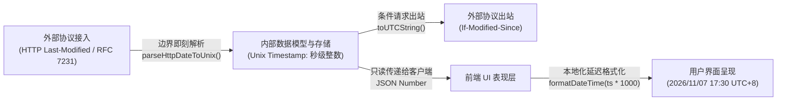

DNS Worker 作为兼顾 Cloudflare Workers 边缘计算与独立服务器（VPS/Docker）常驻守护进程的混合架构项目，在代码工程、数据一致性、安全性及长期维护性方面遵循高度严格的设计与编码规范。本规范是团队协同与工程迭代的核心准则。

---

## 1. 架构与协同设计原则

- **尊重现有架构分层 (Respect Architecture Layers)**：修改或扩展功能前，必须深入分析所属分层（DNS 核心管道、网络接入层、数据持久层、前端 Local-First OPFS 渲染层）及其依赖，保持上下文感知，禁止跨层私自引入紧密耦合。
- **极简侵入式修改 (Minimally Invasive Modifications)**：严格将代码修改限制在目标功能或缺陷范围内。保持既有的变量命名风格、代码格式与架构范式，非必要不进行大范围非关联重构。
- **模块化与单一职责 (Modularity & Single Responsibility)**：保持函数为纯函数或职责明确的单一单元。复杂的业务逻辑必须提取为独立的工具函数或服务模块，禁止在 Controller / 路由处理程序中堆砌复杂计算。

---

## 2. 编码与严格类型规范

- **全链路严格类型 (Strict Typing)**：
  - 在 TypeScript 中，所有数据结构、函数入参与返回值均必须显式定义 Interface、Type 或 Return Type。
  - **严禁滥用 `any`**，禁止依赖隐式推断绕过编译期类型检查。
- **统一命名约定 (Naming Conventions)**：
  - 变量名、普通函数：采用 `camelCase`（如 `listFetcher`、`parseHttpDateToUnix`）。
  - 类、接口、类型、React 组件：采用 `PascalCase`（如 `ListModel`、`ListsTable`、`SingleListSyncResult`）。
  - 全局常量与枚举值：采用 `UPPER_SNAKE_CASE`（如 `DEFAULT_MAX_LIST_BYTES`、`APP_VERSION`）。
- **防御性编程 (Defensive Programming)**：
  - 在处理外部网络请求、上游 DNS 响应、用户表单输入或跨环境 API 时，必须包含完整的异常捕获 (`try/catch`)、空边界保护（Null-Boundary Check）与格式校验。
  - 针对网络瞬态故障（如 TLS 握手抖动、上游 5xx 状态码），应实现优雅退避与自动重试机制。

---

## 3. 统一时间戳数据模型规范 (Timestamp Standardization)

为了彻底根除时区偏差、国际化文本解析歧义及序列化开销，DNS Worker 确立了系统级的统一时间戳模型：

### 核心规范要求：
1. **统一整型 Unix 时间戳 (Integer Unix Timestamp in Seconds)**：
   - 数据库中所有涉及时间的字段（如 `created_at`、`updated_at`、`last_synced_at`、`global_list_metadata.last_modified` 等）、后端领域实体模型（Domain Models）以及内部 REST/RPC 接口，**一律以秒级整型时间戳存储与传输**（SQLite `INTEGER` / TypeScript `number`，以 `Math.floor(Date.now() / 1000)` 为标准时间源）。
   - **严禁**在数据库持久层和数据模型中存储格式化文本（如 ISO-8601、RFC 2822 或 HTTP 日期字符串）。
2. **外部协议边界即刻转换 (Boundary Parsing & Dynamic Serialization)**：
   - 接收外部协议数据（如上游订阅列表响应头中的 `Last-Modified` RFC 7231 文本）时，必须在网络接入边界立即解析并转换为 Unix 时间戳整数后再落库。
   - 向外部协议发起条件请求（如 `If-Modified-Since`）时，由传输层动态将整型时间戳格式化为符合规范的 RFC 日期文本发送。
3. **表现层延迟格式化 (Presentation Layer Formatting)**：
   - 将时间戳转换为人类可读字符串（如 `2026/11/07 17:30:00`）、相对时间计算、用户配置时区（`user.timezone`）偏移等，**必须严格限制在 UI 表现层最终执行**（例如通过前端 `formatDateTime(new Date(timestamp * 1000))` 工具处理）。

---

## 4. 数据库演进与增量迁移规范 (Append-Only Migrations)

由于项目同时面向边缘 Serverless (Cloudflare D1) 与分布式独立服务器 (VPS SQLite / Turso)，数据库迁移采用增量不可变机制：

- **禁止直接篡改已有历史迁移 (Immutable Past Migrations)**：
  - 已经合并或部署的迁移文件（`migrations/0000_*.sql` 至已有序号）属于不可变基线，**严禁直接修改原有数据表的建表 SQL**。
- **新增需求必须新建顺序编号迁移文件**：
  - 结构调整（新增列、字段类型规范重构、索引优化）必须通过递增创建全新的迁移文件实现（例如 `0066_standardize_last_modified_timestamp.sql`）。
- **表结构变更的最佳实践**：
  - 在 SQLite 中修改列属性时，优先采用官方推荐的“临时表替换模式”：
    1. 创建具备目标结构的新临时表（如 `global_list_metadata_new`）；
    2. 将旧表数据复制并按需进行类型清洗转换；
    3. `DROP TABLE` 旧表并重命名新表为原表名。
- **同步更新嵌入式迁移**：
  - 新增迁移文件后，必须执行 `npm run db:generate-migrations`，自动更新 `src/lib/turso/embeddedMigrations.ts`，确保 Cloudflare Workers 边缘无文件系统环境能自动同步应用。

---

## 5. 安全体系与防御性设计

- **严格的 SSRF 防护**：
  - 凡是用户或管理员输入的外部 URL（如订阅拦截规则源、自定义上游 DoH 地址），必须经过 `isSafeUrlWithDnsCheck` 校验，坚决拦截私有内网 IP（RFC 1918）、Loopback 地址、云厂商元数据地址（`169.254.169.254`）及局域网域名。
- **协议合规与最低 HTTP 版本限制规范 (RFC 8484 §5.2)**：
  - DoH 服务与上游查询均严格遵守 RFC 8484 第 5.2 节标准，**将最低 HTTP 版本强制限制在 HTTP/2**。DoH 传输绝不协商或回退到 HTTP/1.1。
  - 在 Serverfull 模式下，HTTPS 服务端通过 `http2.createSecureServer` 原生支持 ALPN `h2` 协商；若接收到 HTTP/1.1 的 DoH 请求，服务端严格回显 `HTTP 505 (HTTP Version Not Supported)`。
  - 上游 DoH 请求失败时，直接如实向前端与日志暴露真实状态码及上游报错摘要，禁止做未经用户显式配置的私自协议降级或静默回退。
- **端到端零知识数据隔离**：
  - 用户分析日志及敏感遥测数据采用后量子密码学（ML-KEM-768）与信封加密，服务端仅存储密文，密钥完全由客户端 WebAuthn / Passkey 托管。

---

## 6. 测试驱动与质量保证 (Test-Driven Mindset)

- **核心链路测试先行**：
  - 针对网络传输器（Transport）、分层协议阶梯、Bloom 过滤器编解码、全局规则编译合并及数据模型变更，必须配齐自动化测试用例。
- **基线覆盖验证**：
  - 提交代码前，需确保以下自动化测试套件通过：
    - `npm test`：密钥兼容性与信封加密测试；
    - `npm run test:global-lists`：全局列表编译、去重与统一时间戳测试；
    - `npm run test:distribute-filter`：管理员下发规则与多用户隔离测试；
    - `npm run test:serverfull`：独立部署模式下的 UDP / DoT / HTTPS 全链路集成测试；
    - `npx tsc --noEmit` & `npm run build`：全工程类型静态检查与构建验证。
