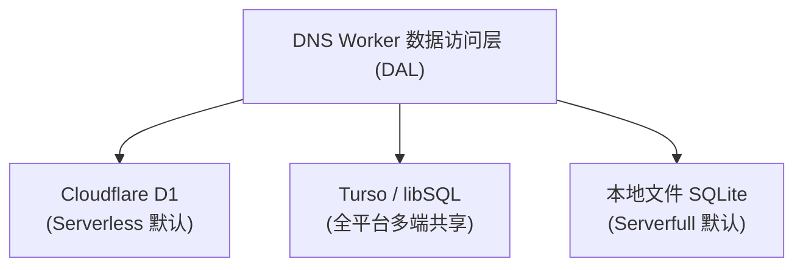

DNS Worker 采用统一的数据抽象层设计，支持 **三种不同的数据库存储引擎**，能够无缝覆盖从 Cloudflare 全球边缘节点到私有物理 VPS 乃至混合部署的各种场景。



---

## 1. 三种存储模式特性对比

| 维度 / 模式 | ☁️ 模式一：Cloudflare D1 | 🌐 模式二：Turso / libSQL | 🖥️ 模式三：本地文件 SQLite |
|---|---|---|---|
| **环境变量标识** | `DATABASE_SERVICE="D1"` | `DATABASE_SERVICE="Turso"` | `DATABASE_SERVICE="File"` |
| **首选运行环境** | Cloudflare Workers 边缘 | **全平台通用**（Workers + VPS） | Linux / VPS / Docker / Windows |
| **存储介质** | 全球边缘托管分布式 SQLite | libSQL 云原生集群 / 自建 sqld | 本地物理 NVMe / SSD 磁盘 |
| **网络协议** | Cloudflare 内部上下文绑定 | HTTPS / WebSocket (Hrana 协议) | 本地 VFS 文件 I/O (`node:sqlite`) |
| **多节点数据同步** | Cloudflare 托管内部复制 | **强实时一致**（所有 Worker 与 VPS 共享同一库） | 独立单机（单节点独占） |
| **外部网络请求** | 无（内存级绑定） | 有（发起 outbound HTTPS 查询） | 无（零网络请求） |
| **结构自动迁移** | 需执行 `wrangler d1 migrations` | **启动/请求时全自动幂等应用** | **启动时全自动幂等建表升级** |
| **运维复杂度** | 零运维 | 极低（注册即可用） | 极低（无需外部服务） |

---

## 2. 模式一：Cloudflare D1 分布式数据库

Cloudflare D1 是 Cloudflare Workers 原生集成的无服务器分布式 SQL 数据库，基于 SQLite 引擎构建，具有与 Worker 同机房就近读取的特性。

### 适用场景
* 完全基于 Cloudflare 基础设施部署 Serverless DoH 服务；
* 追求零基础设施维护、开箱即用的高可用性；
* 单一 Cloudflare 账号下的标准化部署。

### 部署与配置步骤

#### 1. 创建 D1 数据库
在终端运行 Wrangler CLI（或登录 Cloudflare 网页控制台创建）：
```bash
# 创建生产数据库
npx wrangler d1 create dns_worker_db
```
命令执行完毕后，控制台将输出数据库名称与唯一的 `database_id`（UUID 格式）。

#### 2. 配置 `wrangler.toml`
在项目根目录的 `wrangler.toml` 中配置 D1 绑定：
```toml
[[d1_databases]]
binding = "DB"
database_name = "dns_worker_db"
database_id = "xxxxxxxx-xxxx-xxxx-xxxx-xxxxxxxxxxxx"
migrations_dir = "migrations"
```

#### 3. 执行数据库迁移

:::note[执行迁移要求]
首次部署时必须执行数据迁移以初始化用户、配置、规则与日志数据表。
:::

```bash
# 本地开发测试环境初始化
npm run db:migrate:dev

# 生产远程 Cloudflare D1 初始化
npm run db:migrate:prod
```

#### 4. 环境变量设定（可选）
在 Cloudflare Workers 中，若未配置 `DATABASE_SERVICE`，系统默认回退为 `D1`。您亦可显式在 `wrangler.toml` 中指定：
```toml
[vars]
DATABASE_SERVICE = "D1"
```

---

## 3. 模式二：Turso / libSQL 云原生数据库

Turso 是基于开源 **libSQL**（SQLite 的现代进化分支）打造的分布式边缘数据库，通过轻量级 Hrana 协议提供高速 HTTP/WebSocket 查询接口。

### 核心价值：跨节点混合多活统一存储
如果您同时部署了 **Cloudflare Workers 边缘节点** 与 **一台或多台自建 VPS (Serverfull) 节点**：
* 传统 D1 仅能被 Cloudflare Worker 访问，无法直接接入物理 VPS；
* 本地 SQLite 文件仅在当前 VPS 物理磁盘有效，无法在多台服务器或边缘节点间共享；
* **Turso 完美打通了这一断层**：无论是欧洲 VPS、亚太 VPS 还是全球 Cloudflare Workers，均可统一指向同一个 Turso 数据库，实现**全局统一账号、实时同步的自定义拦截规则、统一的接入点配额与集中化查询日志**。

### 部署与配置步骤

#### 1. 注册并创建 Turso 数据库
1. 安装 Turso CLI：
   ```bash
   curl -sSfL https://get.tur.so/install.sh | bash
   ```
2. 登录并创建数据库实例：
   ```bash
   turso auth login
   turso db create dns-worker-db
   ```
3. 查看数据库访问 URL：
   ```bash
   turso db show dns-worker-db --url
   # 输出格式类似: libsql://dns-worker-db-yourorg.turso.io
   ```
4. 创建长久访问凭据 Token：
   ```bash
   turso db tokens create dns-worker-db
   # 输出一串长 JWT 格式字符串
   ```

#### 2. 在 Cloudflare Workers 中接入 Turso
在 `wrangler.toml` 中配置数据库类型与连接地址：
```toml
[vars]
DATABASE_SERVICE = "Turso"
TURSO_DATABASE_URL = "https://dns-worker-db-yourorg.turso.io"
```

将 Auth Token 注入为加密密钥（Secret）：
```bash
npx wrangler secret put TURSO_AUTH_TOKEN
# 粘贴刚刚生成的 Token
```

#### 3. 在独立服务器 / VPS (Serverfull) 中接入 Turso
在配置文件 `/etc/dns-worker/.env` 或启动目录 `.env` 中加入：
```ini
DATABASE_SERVICE=Turso
TURSO_DATABASE_URL=libsql://dns-worker-db-yourorg.turso.io
TURSO_AUTH_TOKEN=eyJhbGciOiJFZERTQTEw...your_token
```

通过 CLI 启停服务时即可生效：
```bash
sudo systemctl restart dns-worker
# 或
dns-worker start
```

:::tip[全自动数据迁移]
与 D1 不同，Turso 模式**无需手动执行 SQL 迁移文件**。DNS Worker 内部封装了基于 Hrana 管道协议的幂等迁移引擎，在服务初次启动或边缘节点初次处理请求时，会自动检测并依次安全应用数据库表结构升级。
:::

#### 4. 私有化部署自建 sqld 方案
若不希望使用 Turso 官方云服务，您可以在内网或自备服务器直接运行官方开源镜像 `tursodatabase/sqld`：
```bash
docker run -d \
  --name sqld \
  -p 8080:8080 \
  -v /data/sqld:/var/lib/sqld \
  -e SQLD_AUTH_JWT_KEY="your_public_key" \
  tursodatabase/sqld:latest
```
此时将 `TURSO_DATABASE_URL` 设为 `http://your-sqld-host:8080` 即可完全私有化闭环。

---

## 4. 模式三：本地物理文件 SQLite 数据库

针对追求 100% 数据自主、不依赖任何云端外部 API 的单机部署场景，DNS Worker 提供了基于宿主环境原生运行的本地 SQLite 引擎。

### 架构特性
* **零外部依赖**：直接调用 Node.js 原生标准库模块 `node:sqlite`（Node.js >= 22.5 或 Bun >= 1.4 内置支持）；
* **极速磁盘 I/O**：默认配置 `PRAGMA journal_mode = WAL;` 与 `PRAGMA synchronous = NORMAL;`，具备高并发读写性能与抗断电崩溃保护；
* **物理私有**：所有 DNS 查询日志与账户凭据完整保存在本地单个 `.sqlite` 文件中，断网环境下依然完美运作。

### 默认持久化路径
* **Linux / systemd**：`/var/lib/dns-worker/dns_worker.sqlite`
* **Windows**：`C:\ProgramData\DNS-Worker\dns_worker.sqlite`

### 部署与配置步骤

#### 1. 标准环境配置（`.env`）
在 `/etc/dns-worker/.env` 中配置：
```ini
DATABASE_SERVICE=File

# 可选：自定义数据文件路径（默认为 /var/lib/dns-worker/dns_worker.sqlite）
SERVERFULL_DB_PATH=/var/lib/dns-worker/dns_worker.sqlite
```

#### 2. Docker 容器持久化挂载
使用 Docker 运行独立节点时，务必将数据库持久化目录挂载至宿主机：
```bash
docker run -d \
  --name dns-worker \
  --restart unless-stopped \
  -p 53:53/udp \
  -p 853:853/tcp \
  -p 10080:10080/tcp \
  -p 10443:10443/tcp \
  -v /var/lib/dns-worker:/var/lib/dns-worker \
  -v /etc/dns-worker:/etc/dns-worker \
  ghcr.io/obein/dns-worker:latest
```

#### 3. 数据备份与灾难恢复
本地 SQLite 文件的数据备份极为简单：
```bash
# 在线安全热备份（利用 sqlite3 命令行）
sqlite3 /var/lib/dns-worker/dns_worker.sqlite ".backup /backup/dns_worker_$(date +%Y%m%d).sqlite"

# 或直接在停机维护时复制文件（需同时包含 -wal 与 -shm 文件，或执行 checkpoint）
cp /var/lib/dns-worker/dns_worker.sqlite /backup/
```

---

## 5. 引擎解析优先级与智能推断机制

DNS Worker 在启动时通过 `getDatabaseService(env, isServerfull)` 函数解析当前生效的数据库引擎：

1. **显式优先级最高**：若环境变量或命令行参数指定了 `DATABASE_SERVICE`（如 `D1`、`Turso`、`File`，大小写不敏感），系统将强制采用指定引擎；
2. **凭据智能推断**：若未显式指定 `DATABASE_SERVICE`，但检测到同时配置了非空的 `TURSO_DATABASE_URL` 与 `TURSO_AUTH_TOKEN`，系统将**自动启用 Turso 模式**；
3. **平台默认保底**：
   * Cloudflare Workers 环境默认回退为 `D1`；
   * 独立服务器 Serverfull (Node.js/Bun/Docker) 环境默认回退为 `File`。

---

## 6. 常见问题排查与注意事项

:::caution[平台兼容性限制]
* **`DATABASE_SERVICE="File"` 无法在 Cloudflare Workers 下使用**：Cloudflare Workers 是无物理持久磁盘的无服务器边缘沙箱，若在 Workers 下误设为 `File`，系统将抛出清晰的错误提示；
* **`DATABASE_SERVICE="D1"` 无法在独立 VPS (Serverfull) 下使用**：D1 为 Cloudflare 专属托管服务，VPS 独立模式请选用 `File` 或 `Turso`。
:::

### 1. Turso 连接超时或协议报错
* **URL 协议前缀**：DNS Worker 会自动规范化 `libsql://` 与 `https://` 协议头。如果您在 Workers 模式下遇到网络握手异常，请优先将 URL 前缀写为标准的 `https://...`。
* **Auth Token 过期**：使用 `turso db tokens create` 时可指定有效时长，若遇到 `401 Unauthorized` 错误，请重新生成 Token 并更新环境配置。

### 2. Linux 本地文件权限错误 (EACCES / Permission Denied)
* 服务默认运行在标准非 root 用户环境。请确保数据目录权限正确：
  ```bash
  sudo mkdir -p /var/lib/dns-worker
  sudo chown -R $USER:$USER /var/lib/dns-worker
  sudo chmod 755 /var/lib/dns-worker
  ```

### 3. 查看当前服务激活的数据库状态
在 VPS 终端执行状态指令，即可一目了然确认当前数据库状态与文件尺寸：
```bash
dns-worker status
```
控制台将输出当前连接的数据库服务类型（`File`、`Turso`）、连接路径或已连接记录条数。
