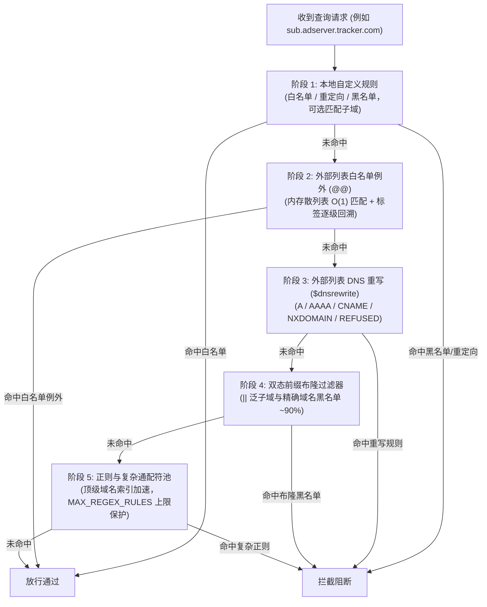

import { Image } from 'astro:assets';
import filterImg from '../../../../../screenshots/dns.obex-filter.webp';
import rulesImg from '../../../../../screenshots/dns.obex-rules.webp';
import logImg from '../../../../../screenshots/dns.obex-log.webp';
import logDetailImg from '../../../../../screenshots/dns.obex-log_detail.webp';

DNS Worker 内置企业级保护性域名过滤引擎，能够在亚毫秒级延迟下并发评估数十万条拦截规则。它可以在网络层为您的家庭与企业设备筑起坚实防线，拦截侵入性广告、行为追踪器、钓鱼欺诈、恶意软件、挖矿程序以及僵尸网络命令与控制（C2）域名。

---

## 1. 威胁防御与保护能力

DNS Worker 在最底层的 DNS 解析阶段即可拦截网络威胁——在建立 TCP 握手或发起 TLS 协商之前即掐断隐患连接。

### 核心拦截威胁类别
- **恶意软件与 C2 域名**：拦截勒索病毒回调、特洛伊木马分发点、僵尸网络控制端及可疑活动域名。
- **钓鱼与欺诈网站**：阻断仿冒金融机构、凭证窃取页面及钓鱼诈骗域名。
- **侵入式广告与追踪器**：在所有移动应用、智能电视和网页中静默屏蔽横幅广告、视频插播广告、弹窗及跨站行为分析追踪。
- **系统与设备遥测**：阻断 Windows、macOS、Android、智能音箱及各类 IoT 设备的激进诊断数据收集。
- **挖矿程序**：阻止浏览器挖矿脚本与后台加密货币挖矿连接。

---

## 2. Web 管理面板规则配置

### 订阅外部规则黑名单

在 Web 管理面板左侧导航中进入 **Filters**（规则订阅），查看和管理当前接入点订阅的外部黑名单。

<Image src={filterImg} alt="规则订阅与外部黑名单" format="webp" />

1. 在 **External Blocklists**（外部规则列表）区域，点击 **Add Subscription**（添加订阅）。
2. 输入订阅 URL（兼容标准 Adblock Plus 语法、Hosts 文件及纯域名列表格式）。
3. 官方推荐的主流过滤源：
   - **OISD Big**：`https://big.oisd.nl`（全面平衡的广告与追踪拦截源）
   - **AdGuard Base**：`https://adguardteam.github.io/HostlistsRegistry/assets/filter_1.txt`
   - **HaGeZi Multi PRO++**：`https://raw.githubusercontent.com/hagezi/dns-blocklists/main/adblock/pro.plus.txt`（高强度威胁拦截）
   - **StevenBlack Hosts**：`https://raw.githubusercontent.com/StevenBlack/hosts/master/hosts`
4. 点击 **Save & Sync**（保存并同步）。DNS Worker 会解析规则并生成紧凑布隆过滤器缓存：
   - **域名总数**：显示解析出的有效去重规则数（通常达数十万条）。
   - **同步状态**：显示 `Normal`（正常同步）、`Outdated`（需更新）或 `Missing`（同步失败）。
   - **全量串行同步**：手动点击“同步所有列表”时，系统采用串行队列更新，并在列表之间保持 1 秒间隔，防范 CPU 激增与锁争用。
   - **单个列表独立同步**：在“列表详情”对话框中支持单独手动同步特定列表，更新后自动重构合并当前配置规则。
   - **自动调度**：系统后台 Cron 任务会定期自动抓取最新规则，每次触发采用时间分片更新单个列表，分摊边缘计算负载。

---

### 配置级、用户级与系统级过滤列表

为了在多设备、多接入点（Profile）以及多用户管理场景下兼顾**全局集中管控**与**终端精细调度**，DNS Worker 提供了结构清晰的三级过滤列表分级体系：

| 层级类型 | 管理入口 | 作用范围 | 标签标识 | 单配置停用 | 独立删除 |
| :--- | :--- | :--- | :--- | :--- | :--- |
| **Profile 级（配置级）** | `/filter`（规则订阅）上方区域 | 仅当前特定的 Profile 接入点生效 | *无特殊标签* | 支持 | 支持 |
| **User 级（用户级）** | `/account`（账号设置）用户过滤列表 | 自动应用于当前用户的所有 Profile | **用户** (绿色 Tag) | 支持（覆盖当前配置） | 仅在 `/account` 删除 |
| **System 级（系统级）** | `/account`（系统过滤列表 - 管理员） | 自动应用于全系统所有用户的全部 Profile | **系统** (蓝色 Tag) | 支持（覆盖当前配置） | 仅由管理员统一撤回 |

#### 1. 核心层级机制详解
- **Profile 级（配置级）列表**：单个接入点专属。管理员或用户在 `/filter` 页直接添加与维护。适用于特定场景的隔离策略（例如专为儿童设备接入点开启家长监控列表，或为物联网 IoT 设备加载专用白名单/黑名单）。
- **User 级（用户级）列表**：账号全局共享。用户在 `/account` 页面统一维护一次，即可自动生效于该用户账号名下的所有现有及未来新建的接入点。免除为多个设备接入点逐一重复添加常用拦截源的繁琐操作。
- **System 级（系统级）列表**：系统安全基线。由实例超级管理员在 `/account` 页面统一下发，作为全站默认的安全防线（如全局已知勒索病毒、钓鱼欺诈拦截源）。管理员亦可随时一键撤回，撤回操作仅清除带有“系统”标识的下发规则，绝不影响用户自建的同名规则。

#### 2. `/filter` 页面多层展示与管理规范
在具体接入点的 `/filter` 规则订阅页面中，系统采用上下双栏分割布局：
- **上方区域（配置专属列表）**：展示当前 Profile 专属的配置级列表，支持新增、手动同步、单独停用与彻底删除。
- **分割线**：清晰区分接入点专属规则与全局继承规则的管辖边界。
- **下方区域（用户与系统列表）**：展示继承自用户账号的「用户」级列表与管理员下发的「系统」级列表。用户可以查阅其规则数量与更新状态：
  - **支持单配置停用**：用户可随时根据特定 Profile 的实际需求，单独停用/启用某项用户或系统列表（系统通过 Profile 级别的状态覆盖表 `profile_user_list_overrides` 实现独立控制，不影响其他接入点）。
  - **不可在 Profile 级删除**：为保障全局配置的一致性，用户级与系统级列表在 `/filter` 页面隐藏删除按钮；如需永久移除，用户级列表需前往 `/account` 页管理，系统级列表由管理员统一撤回。

#### 3. 允许重复与联动停用
- **允许重复订阅**：Profile 级列表与用户/系统级列表**允许存在相同的订阅 URL**。
- **联动停用机制**：当用户在当前 Profile 中停用某个列表时，若当前接入点中存在相同 URL 的其他列表（如同时存在配置级与用户/系统级），系统将**自动联动停用**当前 Profile 中该 URL 对应的所有列表项，防止出现“停用了该项但同名规则仍在后台继续拦截”的误导情况。重新启用时，则仅对当前点击的单项操作。
- **后台高效去重合并**：在后台执行规则同步并编译布隆过滤器与规则池时，系统自动对所有启用的订阅 URL 进行集合去重（`Set<string>`），相同的 URL 仅抓取并编译一次，既保障了多层架构的控制粒度，又彻底避免了冗余的边缘计算与内存消耗。

---

### 自定义白名单、黑名单与重写规则

进入 **Rules**（自定义规则）页面，根据特定需求配置实时生效的个性化规则：

<Image src={rulesImg} alt="自定义规则管理" format="webp" />

- **Allowlist (白名单)**：直接放行的信任域名，优先于外部规则（用于解除误杀或保障公司业务通道）。
- **Blocklist (黑名单)**：明确禁止解析的恶意或广告域名，拦截优先级最高。
- **DNS Rewrites (重写 / 重定向)**：将特定域名解析至指定 IP 地址或内网主机（例如局域网自建服务，或强制开启 SafeSearch 如 `forcesafesearch.google.com`）。
- **子域名匹配规则**：取消单独的“匹配子域名”开关。若要匹配子域名，需使用通配符 `*.example.com`，直接输入 `example.com` 不会匹配子域名。
- **支持匹配语法**：
  - 精确域名：`ad.example.com`
  - 子域名通配符：`*.tracking.company.com` 或 `||adservice.google.com^`
  - 正则表达式：`^analytics-[0-9]+\..*$`

---

### 拦截响应模式

在接入点配置中，可以按需指定拦截发生时的 DNS 响应行为：

| 拦截模式 | 返回行为 | 优势 |
| :--- | :--- | :--- |
| **Zero IP (0.0.0.0 / ::)** | IPv4 返回 `0.0.0.0`，IPv6 返回 `::` | **推荐首选**。客户端以最快速度终止连接，避免超时重试。 |
| **NXDOMAIN** | 返回 RCODE 3 (域名不存在) | 符合标准，向客户端明确指示该域名不存在。 |
| **Refused** | 返回 RCODE 5 (拒绝解析) | 清晰区分常规查询错误与安全策略阻断。 |

---

## 3. 实时威胁审计与查询日志

进入 **Logs**（查询日志）页面，实时监控网络威胁拦截情况与正常请求流动：

<Image src={logImg} alt="实时查询日志与威胁阻断" format="webp" />

- **实时状态标识**：
  - `BLOCK` (红色)：命中黑名单或恶意规则的请求，展示合成的拦截 IP（`0.0.0.0`）及命中原因。
  - `PASS` (绿色)：已成功转发至上游安全递归并正常返回的合法请求。
  - `REWRITE` (蓝色)：命中重写规则并返回预设重定向目标的请求。
- **威胁审计抽屉**：点击任意日志条目即可滑出详细审计抽屉，精准查看命中的规则来源、客户端 IP、地理归属、上游解析耗时及端到端加密状态。

<Image src={logDetailImg} alt="查询日志详情审计抽屉" format="webp" />

---

## 4. 匹配引擎架构：分层混合架构

为在资源受限的环境（如 512MB 内存的 VPS 或 128MB 限制的 Cloudflare Workers 边缘节点）中实现超低延迟的大规模规则匹配，同时完整兼容主流 AdGuard Home 过滤语法，DNS Worker 采用了**分层混合匹配架构**：

1. **分级高效短路**：
   - **阶段 1：本地自定义规则**：优先级最高。支持单域名精确匹配与自定义子域名匹配。
   - **阶段 2：外部列表白名单例外（`@@`）**：采用内存散列表（Hash Set，`Set<string>`）维护，先以 $O(1)$ 查表，再进行父级标签逐级回溯。命中即刻放行，彻底消除布隆过滤器的假阳性误判风险。
   - **阶段 3：外部列表 DNS 重写（`$dnsrewrite`）**：支持将域名实时合成为指定 IPv4、IPv6、CNAME 或阻断状态（NXDOMAIN / REFUSED）。
   - **阶段 4：双态前缀布隆过滤器**：海量静态黑名单的主力防线。通过前缀区分单域名黑名单与带 `||` 的泛子域黑名单，在微秒级时间内完成匹配，杜绝单域名规则误杀子域名。
   - **阶段 5：正则与复杂通配符池**：对 `/regex/` 及复杂通配符建立顶级域名倒排索引，大幅收窄正则评估范围，单配置默认上限为 1000 条。

---

## 5. 过滤环境变量速查

在 `.env`（Serverfull 模式）或 `wrangler.toml`（Serverless 模式）中配置以下过滤参数：

### `MAX_REGEX_RULES`
- **支持模式**：Serverless & Serverfull
- **默认值**：`1000`
- **说明**：单个 Profile 允许合并的最大 AdGuard 正则表达式和复杂通配符规则上限。超额规则将被安全丢弃并记录警告日志，严防复杂正则拖慢 DNS 整体查询性能。

### `PRESET_EXTERNAL_FILTERS`
- **支持模式**：Serverless & Serverfull
- **`wrangler.toml` 格式**：多行 TOML 字符串，内含 JSON 数组对象 `[{ label, url }]`。
- **`.env.serverfull` 格式**：JSON 字符串。
- **默认值**：内置精选过滤源，包括 OISD Big (`https://big.oisd.nl`)、OISD NSFW、AdGuard Base 及 StevenBlack hosts。

### `BLOOM_FALSE_POSITIVE_RATE`
- **支持模式**：Serverless & Serverfull
- **默认值**：`0.0001`（万分之一）
- **说明**：布隆过滤器的误报率设计阈值。极低的万分之一阈值在最小化内存开销的同时彻底压低了二次验证频率。

### `MAX_SYNC_DOMAINS`、`MAX_LIST_DOMAINS` & `MAX_LIST_BYTES`
- **支持模式**：Serverless & Serverfull
- **默认值**：`MAX_SYNC_DOMAINS=1000000`（总计 100 万条上限），`MAX_LIST_DOMAINS=500000`（单列表 50 万条上限），`MAX_LIST_BYTES=20971520`（单列表 20 MB 上限）。
- **说明**：安全保护边界，防止抓取过大规则源时发生无节制内存占用与大流量耗尽。若外部列表超出 `MAX_LIST_BYTES`，系统将安全截断至上限并于列表同步状态明确标注警告，杜绝静默丢失。

### `BLOOM_MEM_TTL` & `SYNC_TIMEOUT_MS`
- **默认值**：`BLOOM_MEM_TTL=600000`（内存缓存 10 分钟），`SYNC_TIMEOUT_MS=30000`（规则下载超时 30 秒）。
- **说明**：编译后布隆过滤器的内存缓存保鲜时间，以及外部列表抓取超时保护。

### `CONFIG_MEM_TTL`
- **支持模式**：Serverless & Serverfull
- **默认值**：`300000`（5 分钟）
- **说明**：每个 Worker 实例在内存中缓存配置文件设置与规则的时长。Cache-Tag 清除（`CF_ZONE_ID` / `CF_PURGE_TOKEN`）会清除所有数据中心的缓存副本，但无法清除其他实例的内存副本，因此该值决定了设置变更最长需要多久才能全局生效。调低该值（如 `60000`）成本很低：重新读取通常由 Cache API 提供，而非访问数据库。

### `SUBSTITUTE_DOMAIN`
- **支持模式**：Serverless & Serverfull
- **默认值**：`www.okx.com`
- **说明**：用于网络连通性探测、测速及上游健康检查的基准域名。

### `BLOCK_MODE`
- **支持模式**：Serverless & Serverfull
- **默认值**：`zero_ip` (`0.0.0.0` / `::`)
- **可选值**：`zero_ip`、`nxdomain`、`refused`
- **说明**：未在接入点单独指定拦截模式时的全局后备策略。
