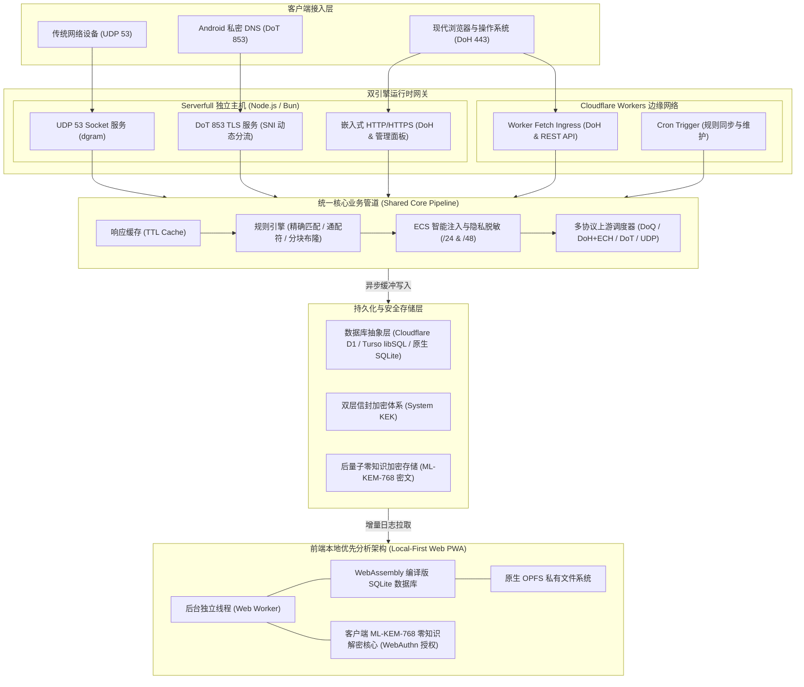
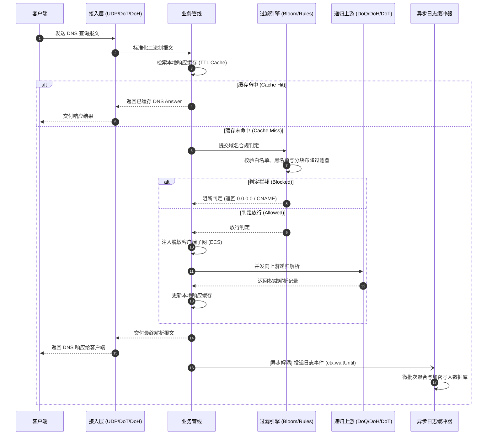
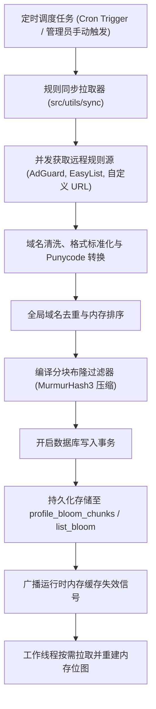
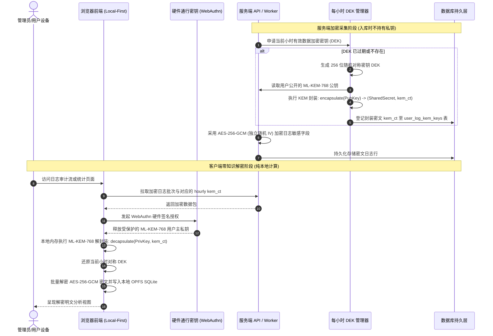
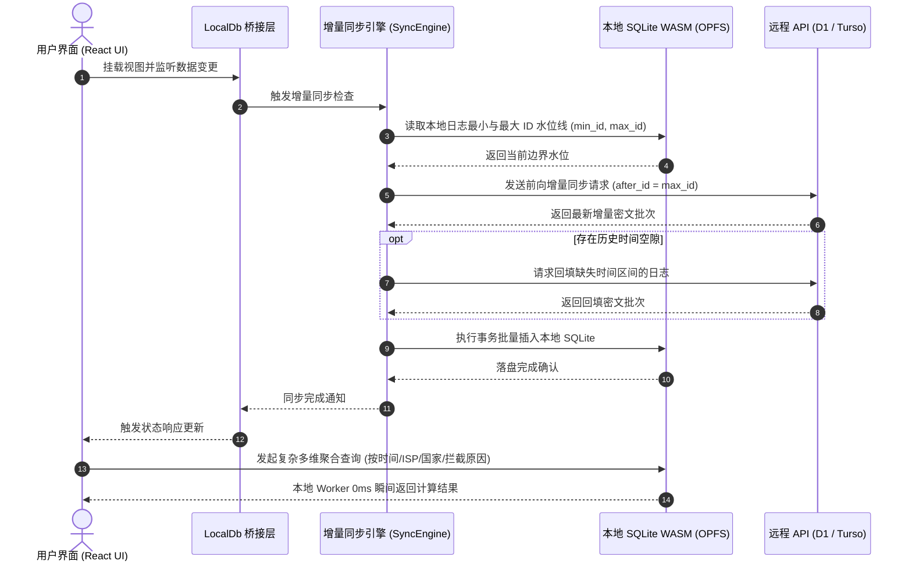

DNS Worker 採用統一業務核心與雙執行時引擎架構，支援在 Cloudflare Workers 邊緣網路以 Serverless 模式執行，或在獨立伺服器/VPS 以 Serverfull 守護程序模式執行。系統覆蓋 DNS 全協議棧解析、分塊布隆規則過濾、後量子端到端加密（PQC E2EE）以及前端本地優先（Local-First OPFS）資料分析。

---

## 架構拓撲

系統通過執行時環境適配層，將同一套核心解析管道部署於邊緣無伺服器計算環境與獨立主機環境。

### 雙引擎統一拓撲



---

### 程式碼工程結構

專案程式碼按職責劃分為核心執行時、前端互動介面、資料庫版本遷移與自動化測試套件：

```text
ObexDNS/
├── src/                               # 核心后端逻辑（Serverless 与 Serverfull 共享）
│   ├── index.ts                       # Cloudflare Workers 入口与计划任务调度
│   ├── api/                           # RESTful 与 WebSocket API 路由分层
│   │   ├── auth/                      # 认证子模块（Turnstile 验证、锁定屏、密码找回）
│   │   ├── account/                   # 账户管理（个人资料、安全凭据、WebAuthn、E2EE 设置）
│   │   ├── profiles/                  # 接入点配置、规则集配置、审计日志及实时 WebSocket 流
│   │   ├── doh.ts                     # RFC 8484 DoH 标准请求处理器
│   │   └── system.ts                  # 系统设置与状态端点
│   ├── pipeline/                      # DNS 解析管线核心（缓存、过滤判定、ECS 注入、上游调度）
│   ├── models/                        # 数据访问层与实体模型（Profile、Rule、List、KEM Key、Session 等）
│   ├── lib/                           # 核心安全与数据库适配库
│   │   ├── turso/                     # Turso / libSQL Hrana v2 协议适配层
│   │   ├── crypto/                    # 密码学套件与每小时 KEM DEK 动态轮换管理
│   │   └── webauthn/                  # FIDO2 / WebAuthn 挑战与验签
│   ├── serverfull/                    # 独立服务器守护进程（UDP 53、DoT 853、嵌入式 HTTP、CLI 与系统服务）
│   └── utils/                         # 工具库（DNS 编解码、ECH 编解码、规则拉取清洗、布隆编译器等）
│
├── web/                               # 本地优先前端单页面应用 (React + TypeScript + Vite)
│   ├── src/views/                     # 业务视图组件（仪表盘、日志流、规则管理、接入点配置、系统设置）
│   ├── src/services/localDb/          # 本地优先 SQLite 领域服务体系（Worker 通信、增量同步、分析查询、存储维护）
│   ├── src/workers/                   # 后台 Web Worker（承载 SQLite WASM 与 OPFS 驱动）
│   └── src/crypto/                    # 浏览器端 NIST FIPS 203 ML-KEM-768 解密核心
│
├── migrations/                        # 版本化 SQL 数据库结构迁移脚本
└── test/                              # 自动化测试矩阵（Turnstile 门控、Turso 协议、Serverfull 守护进程集成测试）
```

---

## 系統分層與元件設計

DNS Worker 在邏輯架構上解構為五大垂直層級：

### 1. 多協議網路接入層

負責將異構傳輸協議的輸入報文統一標準化為二進位制 DNS 報文（DNS Message）：

- **UDP 53 接入元件 (`src/serverfull/udp.ts`)**：基於 Node.js 原生 `dgram` 套接字繫結 `53` 埠，採用無鎖二進位制切片直接讀取報文頭部，內建滑動視窗速率限制防禦 DNS 反彈放大攻擊。
- **DoT 853 接入元件 (`src/serverfull/dot.ts`)**：基於原生 `tls` 模組監聽 `853` 埠，處理 RFC 7858 兩位元組長度字首分包，並在 TLS 握手階段動態提取 SNI 路由接入點（`<profileKey>.dns.example.com`），實現 Android 原生私密 DNS 接入多租戶分流。
- **DoH / HTTP 接入元件 (`src/api/doh.ts`, `src/serverfull/http.ts`)**：實現標準 RFC 8484 規範（支援 GET Base64URL 與 POST 二進位制 Payload），支援 HTTP/2 與 HTTP/3，並在響應中動態注入包含公鑰標識與引數的 RFC 9460 HTTPS / SVCB 資源記錄以支援 ECH（加密客戶端 Hello）。

### 2. 規則引擎與布隆分發層

負責對解析請求進行合規審計與攔截判定：

- **三級級聯過濾判定鏈**：
  1. **白名單優先繞過**：匹配自定義白名單域名，命中直接放行。
  2. **精確與萬用字元規則匹配**：基於倒排域名樹和 Hash 表實現對自定義規則的亞微秒匹配。
  3. **分塊分層布隆過濾器**：針對收錄數十萬至數百萬域名的開源規則集，通過 MurmurHash3 演算法將其壓縮為多組輕量級分塊點陣圖（每塊 256KB~1MB），保持 0 假陰性且假陽性低於 0.1%，記憶體開銷比傳統樹結構降低 90% 以上。
- **規則同步與編譯管道 (`src/utils/sync/`)**：定時拉取外部訂閱，執行流式過濾、域名清洗、Punycode 轉換與去重，編譯完成後分塊持久化至資料庫。

### 3. 核心解析與上游排程層

負責在域名合規放行後，排程遞迴解析器獲取權威結果：

- **解析管線排程器 (`src/pipeline/index.ts`)**：
  - **響應快取 (`src/pipeline/cache.ts`)**：維護帶 TTL 的自適應快取，對攔截域名直接合成攔截響應並設定短 TTL，減少冗餘請求。
  - **ECS (EDNS Client Subnet) 注入與脫敏 (`src/utils/dns/injectEcs.ts`)**：截斷客戶端 IP 為 `/24` (IPv4) 或 `/48` (IPv6) 網段資訊注入請求，使 CDN 獲得就近排程能力的同時隔離客戶端精確 IP。
- **多協議併發上游排程**：同時管理 DoQ (`quic://`)、DoH+ECH (`https://`)、DoT (`tls://`) 與傳統 UDP/TCP 上游，支援併發競速（Race）與故障轉移熔斷機制。

### 4. 資料持久化與儲存抽象層

負責提供跨平臺統一的資料存取介面與敏感資料保護：

- **統一資料庫驅動抽象**：為 Cloudflare D1、Turso / libSQL（通過 Hrana v2 HTTP Pipeline 批次執行與短讀快取）以及本地 `node:sqlite` 提供一致的 `D1Database` 契約。
- **雙層系統信封加密 (`src/utils/envelope.ts`)**：通過系統主金鑰 `KEK_v1`（相容 `KEK_v0`），對儲存於資料表中的敏感憑證（TOTP 金鑰、API Token、Profile Key）在入庫前執行 AES-256-GCM 信封加密。
- **非同步日誌緩衝聚合器 (`src/pipeline/logBatcher.ts`)**：DNS 解析完成後，日誌任務直接投遞至記憶體佇列，藉助 Cloudflare Workers 的 `ctx.waitUntil()` 或 Node.js 非同步事件迴圈在後臺微批次合併寫入，不佔用關鍵響應鏈路時間。

### 5. 前端互動與本地優先層

負責將分析計算與日誌解密下沉至客戶端：

- **WASM SQLite + OPFS 本地儲存**：前端在獨立的 Web Worker 執行緒中執行官方 WebAssembly SQLite 資料庫，並持久化到 Origin Private File System (OPFS)。
- **本地即時多維分析**：日誌全文檢索、客戶端分佈過濾與地理國家流向統計均在本地 Worker 執行緒毫秒級執行，不消耗雲端資料庫讀配額。
- **客戶端後量子零知識解密 (`web/src/crypto/pqc.ts`)**：啟用 E2EE 後，服務端僅儲存密文；客戶端通過 WebAuthn 硬體通行金鑰（Passkey）在瀏覽器記憶體中解開主私鑰，本地還原明文日誌。

---

## 資料流與互動機制

### 1. 端到端 DNS 查詢與解析流



---

### 2. 規則訂閱、編譯與布隆分塊分發流



---

### 3. 審計日誌採集與後量子零知識 E2EE 加密流



---

### 4. 本地優先 (Local-First OPFS) 增量同步與離線查詢流


