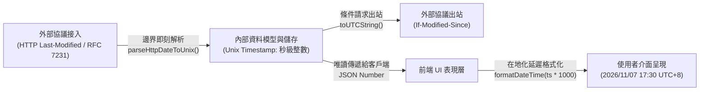

DNS Worker 作為兼顧 Cloudflare Workers 邊緣計算與獨立伺服器（VPS/Docker）常駐守護行程的混合架構專案，在程式碼工程、資料一致性、安全性及長期維護性方面遵循高度嚴格的設計與編碼規範。本規範是團隊協同與工程迭代的核心準則。

---

## 1. 架構與協同設計原則

- **尊重現有架構分層 (Respect Architecture Layers)**：修改或擴展功能前，必須深入分析所屬分層（DNS 核心管道、網路接入層、資料持久層、前端 Local-First OPFS 渲染層）及其依賴，保持上下文感知，禁止跨層私自引入緊密耦合。
- **極簡侵入式修改 (Minimally Invasive Modifications)**：嚴格將程式碼修改限制在目標功能或缺陷範圍內。保持既有的變數命名風格、程式碼格式與架構範式，非必要不進行大範圍非關聯重構。
- **模組化與單一職責 (Modularity & Single Responsibility)**：保持函數為純函數或職責明確的單一單元。複雜的業務邏輯必須提取為獨立的工具函數或服務模組，禁止在 Controller / 路由處理程序中堆砌複雜計算。

---

## 2. 編碼與嚴格型別規範

- **全鏈路嚴格型別 (Strict Typing)**：
  - 在 TypeScript 中，所有資料結構、函數傳入參數與返回值均必須顯式定義 Interface、Type 或 Return Type。
  - **嚴禁濫用 `any`**，禁止依賴隱式推斷繞過編譯期型別檢查。
- **統一命名約定 (Naming Conventions)**：
  - 變數名、普通函數：採用 `camelCase`（如 `listFetcher`、`parseHttpDateToUnix`）。
  - 類別、介面、型別、React 元件：採用 `PascalCase`（如 `ListModel`、`ListsTable`、`SingleListSyncResult`）。
  - 全域常數與列舉值：採用 `UPPER_SNAKE_CASE`（如 `DEFAULT_MAX_LIST_BYTES`、`APP_VERSION`）。
- **防禦性編程 (Defensive Programming)**：
  - 在處理外部網路請求、上游 DNS 響應、使用者表單輸入或跨環境 API 時，必須包含完整的例外捕捉 (`try/catch`)、空邊界保護（Null-Boundary Check）與格式校驗。
  - 針對網路瞬態故障（如 TLS 握手抖動、上游 5xx 狀態碼），應實現優雅退避與自動重試機制。

---

## 3. 統一時間戳資料模型規範 (Timestamp Standardization)

為了徹底根除時區偏差、國際化文字解析歧義及序列化開銷，DNS Worker 確立了系統級的統一時間戳模型：

### 核心規範要求：
1. **統一整型 Unix 時間戳 (Integer Unix Timestamp in Seconds)**：
   - 資料庫中所有涉及時間的欄位（如 `created_at`、`updated_at`、`last_synced_at`、`global_list_metadata.last_modified` 等）、後端領域實體模型（Domain Models）以及內部 REST/RPC 介面，**一律以秒級整型時間戳儲存與傳輸**（SQLite `INTEGER` / TypeScript `number`，以 `Math.floor(Date.now() / 1000)` 為標準時間源）。
   - **嚴禁**在資料庫持久層和資料模型中儲存格式化文字（如 ISO-8601、RFC 2822 或 HTTP 日期字串）。
2. **外部協議邊界即刻轉換 (Boundary Parsing & Dynamic Serialization)**：
   - 接收外部協議資料（如上游訂閱列表響應頭中的 `Last-Modified` RFC 7231 文字）時，必須在網路接入邊界立即解析並轉換為 Unix 時間戳整數後再落庫。
   - 向外部協議發起條件請求（如 `If-Modified-Since`）時，由傳輸層動態將整型時間戳格式化為符合規範的 RFC 日期文字發送。
3. **表現層延遲格式化 (Presentation Layer Formatting)**：
   - 將時間戳轉換為人類可讀字串（如 `2026/11/07 17:30:00`）、相對時間計算、使用者配置時區（`user.timezone`）偏移等，**必須嚴格限制在 UI 表現層最終執行**（例如透過前端 `formatDateTime(new Date(timestamp * 1000))` 工具處理）。

---

## 4. 資料庫演進與增量遷移規範 (Append-Only Migrations)

由於專案同時面向邊緣 Serverless (Cloudflare D1) 與分散式獨立伺服器 (VPS SQLite / Turso)，資料庫遷移採用增量不可變機制：

- **禁止直接篡改已有歷史遷移 (Immutable Past Migrations)**：
  - 已經合併或部署的遷移檔案（`migrations/0000_*.sql` 至已有序號）屬於不可變基準，**嚴禁直接修改原有資料表的建表 SQL**。
- **新增需求必須新建順序編號遷移檔案**：
  - 結構調整（新增欄位、型別規範重構、索引最佳化）必須透過遞增建立全新的遷移檔案實現（例如 `0066_standardize_last_modified_timestamp.sql`）。
- **表結構變更的最佳實踐**：
  - 在 SQLite 中修改欄位屬性時，優先採用官方推薦的「暫存表替換模式」：
    1. 建立具備目標結構的新暫存表（如 `global_list_metadata_new`）；
    2. 將舊表資料複製並按需進行型別清洗轉換；
    3. `DROP TABLE` 舊表並重新命名新表為原表名。
- **同步更新嵌入式遷移**：
  - 新增遷移檔案後，必須執行 `npm run db:generate-migrations`，自動更新 `src/lib/turso/embeddedMigrations.ts`，確保 Cloudflare Workers 邊緣無檔案系統環境能自動同步套用。

---

## 5. 安全體系與防禦性設計

- **嚴格的 SSRF 防護**：
  - 凡是使用者或管理員輸入的外部 URL（如訂閱攔截規則源、自訂上游 DoH 位址），必須經過 `isSafeUrlWithDnsCheck` 校驗，堅決攔截私有內網 IP（RFC 1918）、Loopback 位址、雲端廠商元數據位址（`169.254.169.254`）及區域網路網域名稱。
- **協議合規與最低 HTTP 版本限制規範 (RFC 8484 §5.2)**：
  - DoH 服務與上游查詢均嚴格遵守 RFC 8484 第 5.2 節標準，**將最低 HTTP 版本強制限制在 HTTP/2**。DoH 傳輸絕不協商或回退到 HTTP/1.1。
  - 在 Serverfull 模式下，HTTPS 服務端透過 `http2.createSecureServer` 原生支援 ALPN `h2` 協商；若接收到 HTTP/1.1 的 DoH 請求，服務端嚴格回顯 `HTTP 505 (HTTP Version Not Supported)`。
  - 上游 DoH 請求失敗時，直接如實向前端與日誌暴露真實狀態碼及上游報錯摘要，禁止做未經使用者顯式配置的私自協議降級或靜默回退。
- **端到端零知識資料隔離**：
  - 使用者分析日誌及敏感遙測資料採用後量子密碼學（ML-KEM-768）與信封加密，伺服器端僅儲存密文，金鑰完全由客戶端 WebAuthn / Passkey 託管。

---

## 6. 測試驅動與品質保證 (Test-Driven Mindset)

- **核心鏈路測試先行**：
  - 針對網路傳輸器（Transport）、分層協議階梯、Bloom 過濾器編解碼、全域規則編譯合併及資料模型變更，必須配齊自動化測試用例。
- **基準覆蓋驗證**：
  - 提交程式碼前，需確保以下自動化測試套件通過：
    - `npm test`：金鑰相容性與信封加密測試；
    - `npm run test:global-lists`：全域列表編譯、去重與統一時間戳測試；
    - `npm run test:distribute-filter`：管理員下發規則與多使用者隔離測試；
    - `npm run test:serverfull`：獨立部署模式下的 UDP / DoT / HTTPS 全鏈路整合測試；
    - `npx tsc --noEmit` & `npm run build`：全工程型別靜態檢查與建置驗證。
