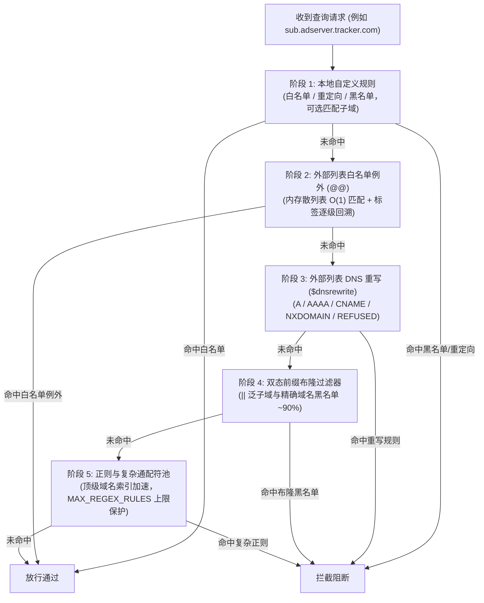

import { Image } from 'astro:assets';
import filterImg from '../../../../../screenshots/dns.obex-filter.webp';
import rulesImg from '../../../../../screenshots/dns.obex-rules.webp';
import logImg from '../../../../../screenshots/dns.obex-log.webp';
import logDetailImg from '../../../../../screenshots/dns.obex-log_detail.webp';

DNS Worker 內建企業級保護性域名過濾引擎，能夠在亞毫秒級延遲下併發評估數十萬條攔截規則。它可以在網路層為您的家庭與企業裝置築起堅實防線，攔截侵入性廣告、行為追蹤器、釣魚欺詐、惡意軟體、挖礦程式以及殭屍網路命令與控制（C2）域名。

---

## 1. 威脅防禦與保護能力

DNS Worker 在最底層的 DNS 解析階段即可攔截網路威脅——在建立 TCP 握手或發起 TLS 協商之前即掐斷隱患連線。

### 核心攔截威脅類別
- **惡意軟體與 C2 域名**：攔截勒索病毒回撥、特洛伊木馬分發點、殭屍網路控制端及可疑活動域名。
- **釣魚與欺詐網站**：阻斷仿冒金融機構、憑證竊取頁面及釣魚詐騙域名。
- **侵入式廣告與追蹤器**：在所有移動應用、智慧電視和網頁中靜默遮蔽橫幅廣告、影片插播廣告、彈窗及跨站行為分析追蹤。
- **系統與裝置遙測**：阻斷 Windows、macOS、Android、智慧音箱及各類 IoT 裝置的激進診斷資料收集。
- **挖礦程式**：阻止瀏覽器挖礦指令碼與後臺加密貨幣挖礦連線。

---

## 2. Web 管理面板規則配置

### 訂閱外部規則黑名單

在 Web 管理面板左側導航中進入 **Filters**（規則訂閱），檢視和管理當前接入點訂閱的外部黑名單。

<Image src={filterImg} alt="規則訂閱與外部黑名單" format="webp" />

1. 在 **External Blocklists**（外部規則列表）區域，點選 **Add Subscription**（新增訂閱）。
2. 輸入訂閱 URL（相容標準 Adblock Plus 語法、Hosts 檔案及純域名列表格式）。
3. 官方推薦的主流過濾源：
   - **OISD Big**：`https://big.oisd.nl`（全面平衡的廣告與追蹤攔截源）
   - **AdGuard Base**：`https://adguardteam.github.io/HostlistsRegistry/assets/filter_1.txt`
   - **HaGeZi Multi PRO++**：`https://raw.githubusercontent.com/hagezi/dns-blocklists/main/adblock/pro.plus.txt`（高強度威脅攔截）
   - **StevenBlack Hosts**：`https://raw.githubusercontent.com/StevenBlack/hosts/master/hosts`
4. 點選 **Save & Sync**（儲存並同步）。DNS Worker 會解析規則並生成緊湊布隆過濾器快取：
   - **域名總數**：顯示解析出的有效去重規則數（通常達數十萬條）。
   - **同步狀態**：顯示 `Normal`（正常同步）、`Outdated`（需更新）或 `Missing`（同步失敗）。
   - **全量串行同步**：手動點選“同步所有列表”時，系統採用序列佇列更新，並在列表之間保持 1 秒間隔，防範 CPU 激增與鎖爭用。
   - **單個列表獨立同步**：在“列表詳情”對話方塊中支援單獨手動同步特定列表，更新後自動重構合併當前配置規則。
   - **自動排程**：系統後臺 Cron 任務會定期自動抓取最新規則，每次觸發採用時間分片更新單個列表，分攤邊緣計算負載。

---

### 配置級、使用者級與系統級過濾列表

為了在多裝置、多接入點（Profile）以及多使用者管理場景下兼顧**全域集中管控**與**終端精細調度**，DNS Worker 提供了結構清晰的三級過濾列表分級體系：

| 層級類型 | 管理入口 | 作用範圍 | 標籤標識 | 單設定停用 | 獨立刪除 |
| :--- | :--- | :--- | :--- | :--- | :--- |
| **Profile 級（設定級）** | `/filter`（規則訂閱）上方區域 | 僅當前特定的 Profile 接入點生效 | *無特殊標籤* | 支援 | 支援 |
| **User 級（使用者級）** | `/account`（帳號設定）使用者過濾列表 | 自動套用於當前使用者的所有 Profile | **使用者** (綠色 Tag) | 支援（覆蓋當前設定） | 僅在 `/account` 刪除 |
| **System 級（系統級）** | `/account`（系統過濾列表 - 管理員） | 自動套用於全系統所有使用者的全部 Profile | **系統** (藍色 Tag) | 支援（覆蓋當前設定） | 僅由管理員統一撤回 |

#### 1. 核心層級機制詳解
- **Profile 級（設定級）列表**：單個接入點專屬。管理員或使用者在 `/filter` 頁直接新增與維護。適用於特定場景的隔離策略（例如專為兒童裝置接入點開啟家長監控列表，或為物聯網 IoT 裝置載入專用白名單/黑名單）。
- **User 級（使用者級）列表**：帳號全域共享。使用者在 `/account` 頁面統一維護一次，即可自動生效於該使用者帳號名下的所有現有及未來新建的接入點。免除為多個裝置接入點逐一重複新增常用攔截源的繁瑣操作。
- **System 級（系統級）列表**：系統安全基線。由實例超級管理員在 `/account` 頁面統一下發，作為全站預設的安全防線（如全域已知勒索病毒、釣魚欺詐攔截源）。管理員亦可隨時一鍵撤回，撤回操作僅清除帶有「系統」標識的下發規則，絕不影響使用者自建的同名規則。

#### 2. `/filter` 頁面多層展示與管理規範
在具體接入點的 `/filter` 規則訂閱頁面中，系統採用上下雙欄分割佈局：
- **上方區域（設定專屬列表）**：展示當前 Profile 專屬的設定級列表，支援新增、手動同步、單獨停用與徹底刪除。
- **分割線**：清晰區分接入點專屬規則與全域繼承規則的管轄邊界。
- **下方區域（使用者與系統列表）**：展示繼承自使用者帳號的「使用者」級列表與管理員下發的「系統」級列表。使用者可以查閱其規則數量與更新狀態：
  - **支援單設定停用**：使用者可隨時根據特定 Profile 的實際需求，單獨停用/啟用某項使用者或系統列表（系統透過 Profile 層級的狀態覆蓋表 `profile_user_list_overrides` 實現獨立控制，不影響其他接入點）。
  - **不可在 Profile 級刪除**：為保障全域設定的一致性，使用者級與系統級列表在 `/filter` 頁面隱藏刪除按鈕；如需永久移除，使用者級列表需前往 `/account` 頁管理，系統級列表由管理員統一撤回。

#### 3. 允許重複與聯動停用
- **允許重複訂閱**：Profile 級列表與使用者/系統級列表**允許存在相同的訂閱 URL**。
- **聯動停用機制**：當使用者在當前 Profile 中停用某個列表時，若當前接入點中存在相同 URL 的其他列表（如同時存在設定級與使用者/系統級），系統將**自動聯動停用**當前 Profile 中該 URL 對應的所有列表項，防止出現「停用了該項但同名規則仍在後臺繼續攔截」的誤導情況。重新啟用時，則僅對當前點選的單項操作。
- **後臺高效去重合併**：在後臺執行規則同步並編譯布隆過濾器與規則池時，系統自動對所有啟用的訂閱 URL 進行集合去重（`Set<string>`），相同的 URL 僅抓取並編譯一次，既保障了多層架構的控制粒度，又徹底避免了冗餘的邊緣計算與記憶體消耗。

---

### 自定義白名單、黑名單與重寫規則

進入 **Rules**（自定義規則）頁面，根據特定需求配置即時生效的個性化規則：

<Image src={rulesImg} alt="自定義規則管理" format="webp" />

- **Allowlist (白名單)**：直接放行的信任域名，優先於外部規則（用於解除誤殺或保障公司業務通道）。
- **Blocklist (黑名單)**：明確禁止解析的惡意或廣告域名，攔截優先順序最高。
- **DNS Rewrites (重寫 / 重定向)**：將特定域名解析至指定 IP 地址或內網主機（例如區域網自建服務，或強制開啟 SafeSearch 如 `forcesafesearch.google.com`）。
- **子域名匹配規則**：取消單獨的“匹配子域名”開關。若要匹配子域名，需使用萬用字元 `*.example.com`，直接輸入 `example.com` 不會匹配子域名。
- **支援匹配語法**：
  - 精確域名：`ad.example.com`
  - 子域名萬用字元：`*.tracking.company.com` 或 `||adservice.google.com^`
  - 正規表示式：`^analytics-[0-9]+\..*$`

---

### 攔截響應模式

在接入點配置中，可以按需指定攔截髮生時的 DNS 響應行為：

| 攔截模式 | 返回行為 | 優勢 |
| :--- | :--- | :--- |
| **Zero IP (0.0.0.0 / ::)** | IPv4 返回 `0.0.0.0`，IPv6 返回 `::` | **推薦首選**。客戶端以最快速度終止連線，避免超時重試。 |
| **NXDOMAIN** | 返回 RCODE 3 (域名不存在) | 符合標準，向客戶端明確指示該域名不存在。 |
| **Refused** | 返回 RCODE 5 (拒絕解析) | 清晰區分常規查詢錯誤與安全策略阻斷。 |

---

## 3. 即時威脅審計與查詢日誌

進入 **Logs**（查詢日誌）頁面，即時監控網路威脅攔截情況與正常請求流動：

<Image src={logImg} alt="即時查詢日誌與威脅阻斷" format="webp" />

- **即時狀態標識**：
  - `BLOCK` (紅色)：命中黑名單或惡意規則的請求，展示合成的攔截 IP（`0.0.0.0`）及命中原因。
  - `PASS` (綠色)：已成功轉發至上游安全遞歸併正常返回的合法請求。
  - `REWRITE` (藍色)：命中重寫規則並返回預設重定向目標的請求。
- **威脅審計抽屜**：點選任意日誌條目即可滑出詳細審計抽屜，精準檢視命中的規則來源、客戶端 IP、地理歸屬、上游解析耗時及端到端加密狀態。

<Image src={logDetailImg} alt="查詢日誌詳情審計抽屜" format="webp" />

---

## 4. 匹配引擎架構：分層混合架構

為在資源受限的環境（如 512MB 記憶體的 VPS 或 128MB 限制的 Cloudflare Workers 邊緣節點）中實現超低延遲的大規模規則匹配，同時完整相容主流 AdGuard Home 過濾語法，DNS Worker 採用了**分層混合匹配架構**：

1. **分級高效短路**：
   - **階段 1：本地自定義規則**：優先順序最高。支援單域名精確匹配與自定義子域名匹配。
   - **階段 2：外部列表白名單例外（`@@`）**：採用記憶體散列表（Hash Set，`Set<string>`）維護，先以 $O(1)$ 查表，再進行父級標籤逐級回溯。命中即刻放行，徹底消除布隆過濾器的假陽性誤判風險。
   - **階段 3：外部列表 DNS 重寫（`$dnsrewrite`）**：支援將域名即時合成為指定 IPv4、IPv6、CNAME 或阻斷狀態（NXDOMAIN / REFUSED）。
   - **階段 4：雙態字首布隆過濾器**：海量靜態黑名單的主力防線。通過字首區分單域名黑名單與帶 `||` 的泛子域黑名單，在微秒級時間內完成匹配，杜絕單域名規則誤殺子域名。
   - **階段 5：正則與複雜萬用字元池**：對 `/regex/` 及複雜萬用字元建立頂級域名倒排索引，大幅收窄正則評估範圍，單配置預設上限為 1000 條。

---

## 5. 過濾環境變數速查

在 `.env`（Serverfull 模式）或 `wrangler.toml`（Serverless 模式）中配置以下過濾引數：

### `MAX_REGEX_RULES`
- **支援模式**：Serverless & Serverfull
- **預設值**：`1000`
- **說明**：單個 Profile 允許合併的最大 AdGuard 正規表示式和複雜萬用字元規則上限。超額規則將被安全丟棄並記錄警告日誌，嚴防複雜正則拖慢 DNS 整體查詢效能。

### `PRESET_EXTERNAL_FILTERS`
- **支援模式**：Serverless & Serverfull
- **`wrangler.toml` 格式**：多行 TOML 字串，內含 JSON 陣列物件 `[{ label, url }]`。
- **`.env.serverfull` 格式**：JSON 字串。
- **預設值**：內建精選過濾源，包括 OISD Big (`https://big.oisd.nl`)、OISD NSFW、AdGuard Base 及 StevenBlack hosts。

### `BLOOM_FALSE_POSITIVE_RATE`
- **支援模式**：Serverless & Serverfull
- **預設值**：`0.0001`（萬分之一）
- **說明**：布隆過濾器的誤報率設計閾值。極低的萬分之一閾值在最小化記憶體開銷的同時徹底壓低了二次驗證頻率。

### `MAX_SYNC_DOMAINS`、`MAX_LIST_DOMAINS` & `MAX_LIST_BYTES`
- **支援模式**：Serverless & Serverfull
- **預設值**：`MAX_SYNC_DOMAINS=1000000`（總計 100 萬條上限），`MAX_LIST_DOMAINS=500000`（單列表 50 萬條上限），`MAX_LIST_BYTES=20971520`（單列表 20 MB 上限）。
- **說明**：安全保護邊界，防止抓取過大規則源時發生無節制記憶體佔用與大流量耗盡。若外部列表超出 `MAX_LIST_BYTES`，系統將安全截斷至上限並於列表同步狀態明確標註警告，杜絕靜默丟失。

### `BLOOM_MEM_TTL` & `SYNC_TIMEOUT_MS`
- **預設值**：`BLOOM_MEM_TTL=600000`（記憶體快取 10 分鐘），`SYNC_TIMEOUT_MS=30000`（規則下載超時 30 秒）。
- **說明**：編譯後布隆過濾器的記憶體快取保鮮時間，以及外部列表抓取超時保護。

### `CONFIG_MEM_TTL`
- **支援模式**：Serverless & Serverfull
- **預設值**：`300000`（5 分鐘）
- **說明**：每個 Worker 例項在記憶體中快取配置檔案設定與規則的時長。Cache-Tag 清除（`CF_ZONE_ID` / `CF_PURGE_TOKEN`）會清除所有資料中心的快取副本，但無法清除其他例項的記憶體副本，因此該值決定了設定變更最長需要多久才能全域性生效。調低該值（如 `60000`）成本很低：重新讀取通常由 Cache API 提供，而非訪問資料庫。

### `SUBSTITUTE_DOMAIN`
- **支援模式**：Serverless & Serverfull
- **預設值**：`www.okx.com`
- **說明**：用於網路連通性探測、測速及上游健康檢查的基準域名。

### `BLOCK_MODE`
- **支援模式**：Serverless & Serverfull
- **預設值**：`zero_ip` (`0.0.0.0` / `::`)
- **可選值**：`zero_ip`、`nxdomain`、`refused`
- **說明**：未在接入點單獨指定攔截模式時的全域性後備策略。
